# Ion Sim

**A SIMION-style ion optics and ion mobility simulator in Python, with a desktop app.**

[](https://github.com/anderson509chris/ION-SIM/actions/workflows/build.yml)


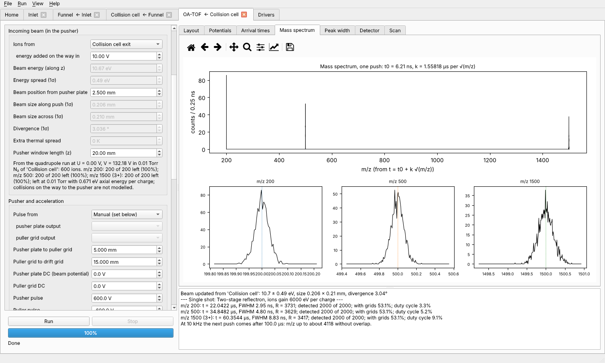

Ion Sim solves electrode fields on a grid, flies thousands of ions through them, and checks the results against theory. It currently models six devices, plus a device builder for your own drawings:

* **Quadrupole mass filter:** four round rods with RF + DC, a Laplace field solve, RK4 ion flight and a Mathieu stability check.
* **TWAVE traveling-wave ion mobility separation:** stepped electrode boards in 4 Torr gas, with mobility drift and diffusion.
* **FAIMS:** an asymmetric waveform across a planar gap at 1 atm, field-dependent mobility α(E/N), CV spectra and dispersion plots.
* **ESI inlet capillary:** spray region, choked capillary flow and free-jet expansion, with ion velocity and kinetic energy from the emitter to the skimmer.
* **Ion funnel:** the PNNL stacked-ring funnel (copper rings on FR4 PCBs), a planar two-board funnel, or **your own electrodes imported from STEP, STL or OBJ**, with RF + DC fields and ion flight through 1–10 Torr gas. PCB dielectric, a computed **gas flow field** and the beam's **space charge** are included.
* **OA-TOF:** an orthogonal-acceleration time-of-flight analyser: the beam in the pusher, the pusher and puller pulse (with real rise times), acceleration, drift, a single- or two-stage reflectron (or linear) and the detector. Arrival times, mass spectra, resolution, what limits the peak width, where ions land on the detector, duty cycle, scans of any setting and an automatic reflectron tune.
* **Device builder:** load a **DXF** drawing or a **STEP / STL / OBJ** model, click each electrode to see and set its DC, RF and TWAVE phase (colored by voltage), apply a DC gradient or an 8-phase TWAVE pattern across many pads at once, then solve and fly ions. Works for flat boards (TWAVE), ring stacks drawn as a profile, rod sets, and full 3D parts.
* **Drivers:** build your electronics once (a TWAVE/RF combiner with 16 outputs, a quad RF supply with 8 excitation tones, a TOF pusher and puller, an RF pair, DC channels) and wire their outputs to electrodes in the Quadrupole, OA-TOF and Device builder tabs. Each output can carry DC, RF, a TWAVE phase with real edge rise times, any number of excitation tones, a pulse, and an **imported waveform: the output of a SPICE model (ngspice or LTspice) or a trace captured from a Rigol oscilloscope**, so electrodes see what the real circuit puts out, ringing and droop included.
* **Ion heating:** every gas-phase flight (funnel, Device builder, TWAVE) tracks each ion's effective and internal temperature, the collision energy, where along the device ions get hottest, and optionally how many survive intact (fragmentation / unfolding estimate).

---

## Contents

* [Quick start](#quick-start)
* [The desktop app](#the-desktop-app)
* [Example results](#example-results)
* [How it works](#how-it-works)
* [Validation](#validation)
* [Limits and roadmap](#limits-and-roadmap)
* [Project layout](#project-layout)

---

## Quick start

```bash
git clone https://github.com/anderson509chris/ION-SIM.git
cd ION-SIM
python3 -m venv .venv
source .venv/bin/activate          # Windows: .venv\Scripts\activate
pip install -r requirements.txt
python ion_sim_app.py              # launches the Ion Sim workspace (add --classic for the old tabbed window)
```

Requires Python 3.12 or newer. Dependencies: NumPy, SciPy, Matplotlib, PySide6, and for imported geometry PyAMG (3D field solver), ezdxf (DXF), trimesh (STL/OBJ) and gmsh (STEP/IGES).

On Linux, gmsh and Qt need a few system libraries: `sudo apt install libglu1-mesa libxcursor1 libxinerama1 libxft2 libegl1 libxkbcommon0`.

To check an install, run `python tests/smoke_test.py` (under a minute). It loads the example DXF and STEP files, solves them and flies ions.

### Standalone app (no Python needed)

| Platform | How |
|---|---|
| **Download** | Every push builds Windows, macOS and Linux versions. Grab the zip from the latest run on the [Actions tab](https://github.com/anderson509chris/ION-SIM/actions). |
| Windows | Double-click `build_windows.bat`, then run `dist\IonSim\IonSim.exe`. |
| macOS / Linux | `./build.sh`, then open `dist/`. |

PyInstaller can only build for the operating system it runs on, which is why there is one build per OS.

---

## The desktop app

The app opens on **Home**, a start page listing every device. Each pick opens a **model** in its own tab, laid out like the classic tabs: settings in one scrolling column with **Run**, **Stop** and progress under it, the plot tabs on the right and the results text under the plots. Several models can be open at once (two funnels, a funnel and a TOF, …); the **Drivers** tab at the end holds the electronics they share.

* **Tabs.** Double-click a model's tab to rename it, close it with its ×, drag tabs to reorder them, and right-click a tab to run, rename or close it. Home lists the open models under **Open models**.
* **Stages.** Models chain into one instrument, **ESI inlet → ion funnel → quadrupole (or collision cell) → OA-TOF**, by a "… from" row at the top of a model's gas or beam settings (or right-click its tab > **Take ions from**):
  * an **ion funnel** takes its pressure, gas throughput and ion species from an ESI inlet (**Gas > Gas and ions from**), and switches to the flow-field gas model the first time;
  * a **quadrupole** takes the ions that left a funnel or Device builder model, ion by ion (**Beam > Ions from**): each keeps its position and side speed and gains **energy added on the way in**, the DC step to the rods (ions broken up by heating are dropped; their RF phase is new);
  * an **OA-TOF** takes its beam (energy and spread, size, divergence) and ion mixture from a quadrupole, funnel or Device builder exit (**Incoming beam > Ions from**; scaled so the most abundant species has 2000 ions).

  Each model reads the last run of the one before it, and the tab shows the link (*OA-TOF ← Collision cell*). **Run > Run with the stages before it** (F6) runs the whole chain in order.
* **Instrument.** The Instrument tab starts from a CAD model of the whole system. **Load STEP…** reads every solid (chambers, capillary, funnel boards, rods, TOF plates; STL and OBJ work too) and draws them cut along the ion axis, from the side and from above, and in 3D. Click a part's outline (Ctrl or Shift click for more), pick what it is (a model, or *Chamber or wall*), give it a stage name and press **Tag**; parts with the same stage name are one model, such as both boards of a planar funnel. **Make linked models** then opens a tab per stage, named after it, in the order the stages sit along the ion path, each linked to the stage before it that can feed it. Load each stage's own detailed geometry in its tab (the planar funnel's DXF, for example) and run it alone or the whole chain with F6. The CAD model and its tags are saved with the setup. `examples/geometry/instrument.step` (made by `make_instrument_step.py`) is an inlet, planar funnel, interface, quadrupole and TOF pusher in two chambers to try it on.
* **Speeds along the instrument.** After each run the Instrument tab's **Speeds** plot shows the gas speed (top) and the ions' speed along the axis (bottom, median of the recorded ions, per species) through every model that has run, laid end to end in chain order, or at their tagged places when the stages came from the CAD model. The inlet gives its gas and ion speeds, the funnel and Device builder their gas flow and ions, the quadrupole its ions (its gas is still).
* **Setups.** **File > Save setup** (Ctrl+Shift+S) writes the whole workspace to one `.ionsetup` file: every model with all its settings and ion tables, which model feeds which, the drivers, and the geometry files the funnel and Device builder use (named relative to the setup, so keep them beside it or below it). **File > Open setup** (Ctrl+O) replaces the open models with the saved ones; **New setup** starts empty. When the app closes it keeps the setup for next time, so it opens on Home with everything as you left it. Results are not saved: run again (F6 for a chain). A saved driver that differs from your library's driver of the same name comes in as *name (from setup)*, and the setup's models use that one.
* **Run** (F5) runs the model in front, **Stop** (Shift+F5) stops it.

Runs happen in the background. Every plot can be zoomed, panned and saved (**File > Save current plot**), and **File > Export results (CSV)** writes the selected model's numbers out. The earlier one-tab-per-device window is still there: **View > Classic tabs window**, or `python ion_sim_app.py --classic`; there the OA-TOF tab can take its ions from the Quadrupole, Ion funnel or Device builder tab the same way. The sections below describe each device.

| Home | OA-TOF at the end of inlet → funnel → collision cell, after Run with the stages before it |
|---|---|
| 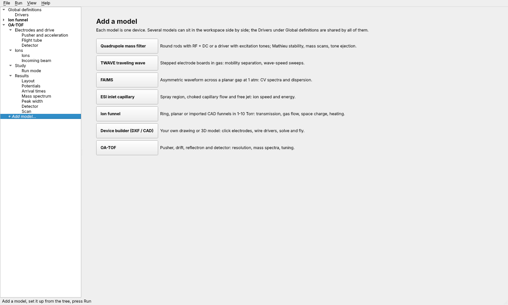 |  |

| Instrument tab: parts tagged as stages (planar funnel selected) | The same instrument in 3D |
|---|---|
| 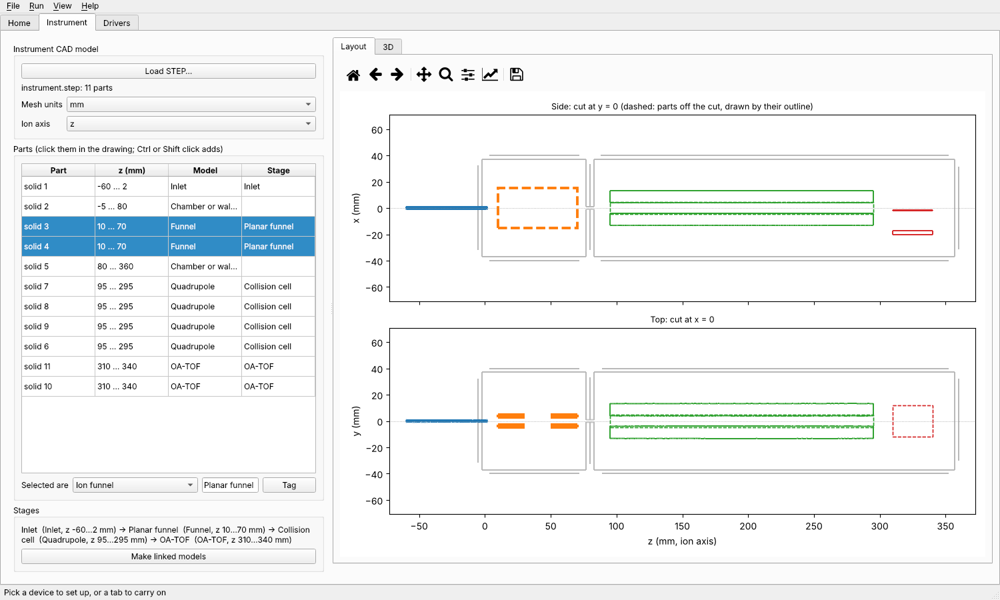 | 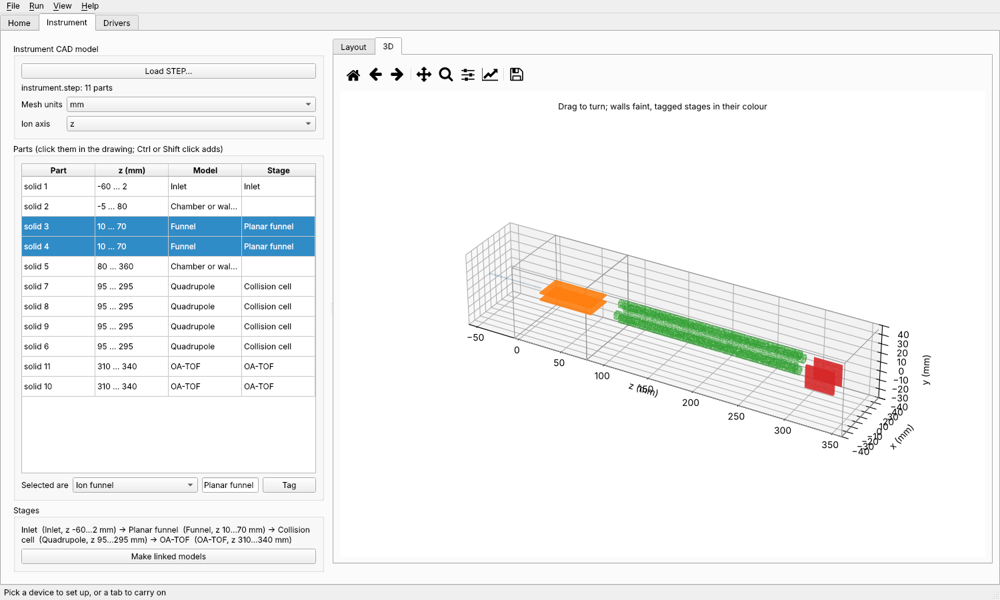 |

| Speeds along the instrument: inlet → funnel → collision cell |
|---|
| 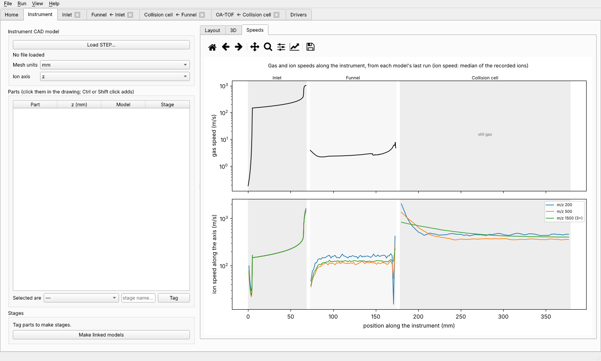 |

**3D paths.** The quadrupole, ion funnel and Device builder tabs have a **3D** plot next to Trajectories: the recorded ion paths with the electrodes around them, which you can turn by dragging and zoom by right-dragging. The electrodes come from the solver grid, so it works for every geometry (rings, boards, rods and imported CAD); the front half (x < 0) is cut away so the ions inside stay in sight.

| Ring funnel in 3D | Quadrupole in 3D |
|---|---|
| 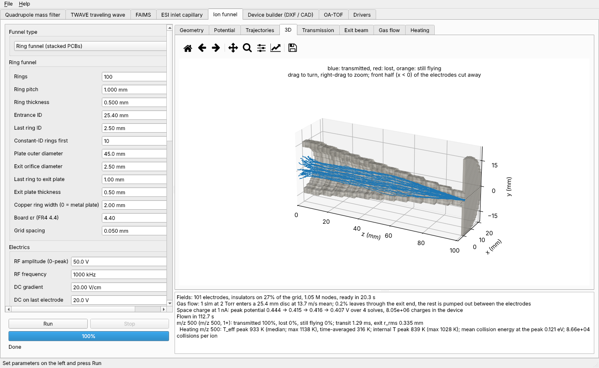 | 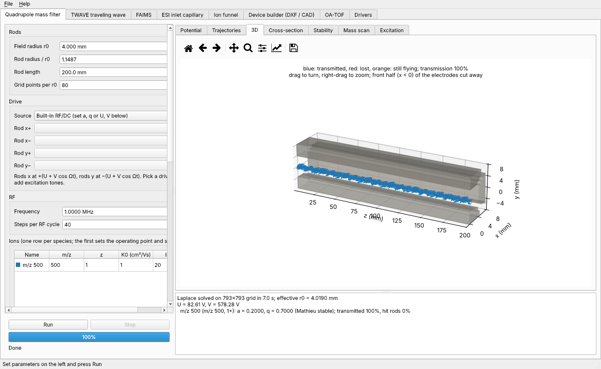 |
| **TWAVE board in 3D (Device builder)** | **Ring profile in 3D (Device builder)** |
| 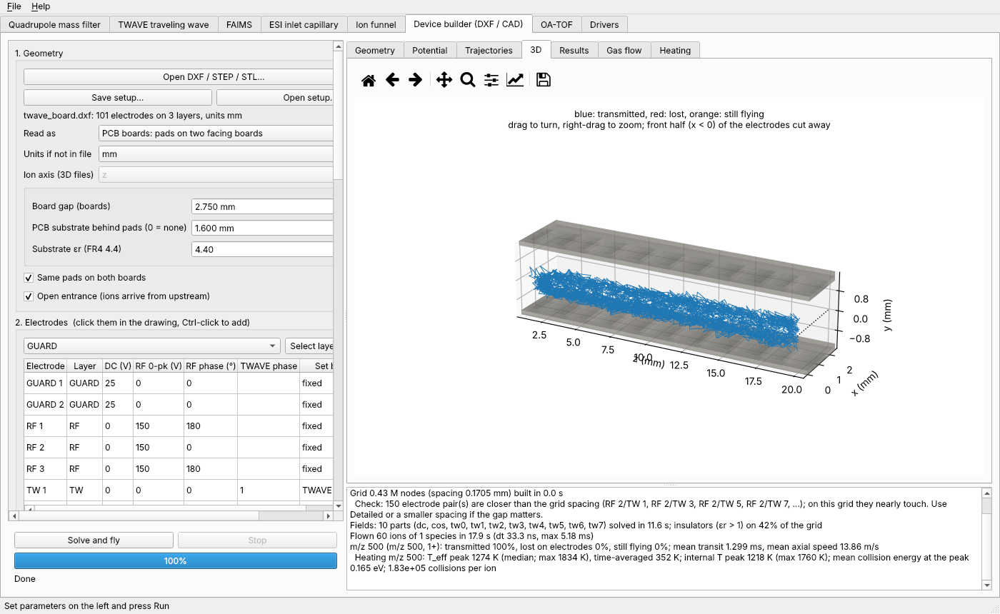 | 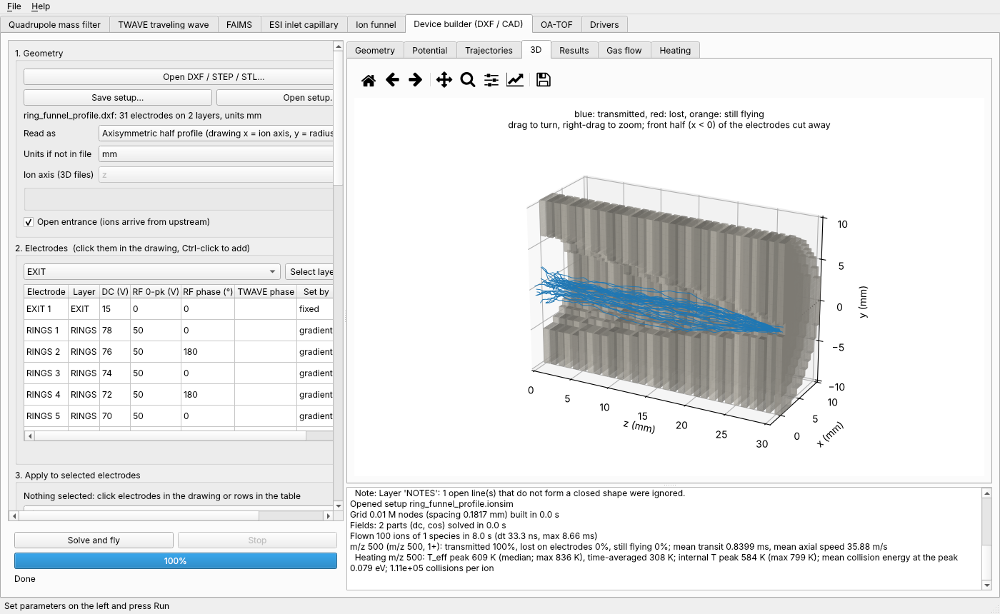 |

**Ion mixtures.** The quadrupole, TWAVE, ion funnel and device builder tabs take their ions from an **Ions** table: one row per species (name, m/z, charge, K0, number of ions), with **Add** (copies the selected row) and **Remove**. All species fly together in one run. Trajectories are coloured by species (solid: transmitted, dotted: lost, dashed: still flying), arrival-time and exit plots split by species, and the results box and CSV give transmission, transit time and heating for each species. Where a tab needs one reference ion (the quadrupole's a/q operating point and mass scan, the funnel's m/z scan and RF effective-potential map), it uses the first row.

### Quadrupole mass filter

Rod geometry, RF frequency, ions, beam and operating point (a, q or U, V, kept in sync, set for the first ion in the table). It runs either a single operating point, with every ion's own (a, q) marked on the stability diagram, or a full mass scan. Plot tabs: Potential, Trajectories, 3D, Cross-section, Stability, Mass scan and Excitation.

**Collision gas** turns the rods into a collision cell or cooling quadrupole: pressure (0 = vacuum), gas (He, N₂, Ar), temperature, an **axial drag field** (V/cm) that pushes slowed ions through, and a max flight time. Each ion's cross section comes from its K0 in the ion table. The log gives, per species, the collisions per ion and the centre-of-mass energy of the first and hardest collision (the CID energy), and warns when steps are too long for the collision rate or ions are still in the rods at the end. Trajectory runs use the gas; mass and excitation scans fly in vacuum.

| Collision cell: funnel ions into 0.01 Torr N₂, 0.5 V/cm drag field |
|---|
| 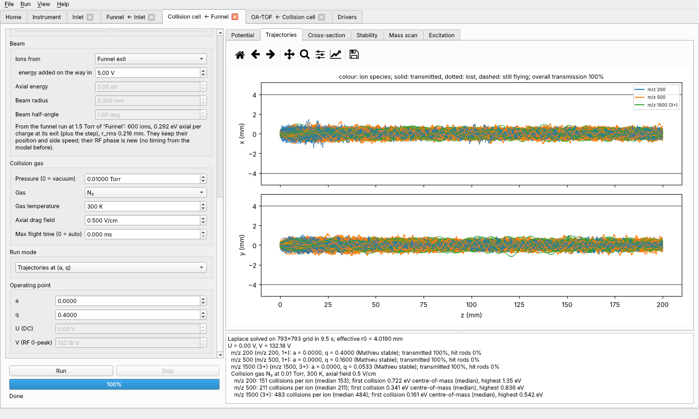 |

Under **Drive**, pick a driver from the Drivers tab instead of the built-in RF/DC, and choose which output goes on each rod (x+, x−, y+, y−). The tab then works out the excitation type from the tone signs on the rods: tones added with the RF (+ on one pair, − on the other) are quadrupolar and eject at twice the secular frequency; tones across one rod pair are dipolar and eject at the secular frequency. It lists the m/z each tone hits, and **Aim tone k at m/z** sets a tone's frequency for you. **Transmission vs m/z (excitation scan)** flies a log-spaced m/z range (plus every predicted notch) and plots the notches with the tone resonances marked (with 8 tones close together, their notches and weaker side resonances overlap into a broad rejection band, as in the example); the **Excitation** plot shows the secular frequencies against m/z with the tones drawn across them, so crossings are the ejected masses.

| Excitation scan with 8 tones on the RF | Tones against the secular frequencies |
|---|---|
| 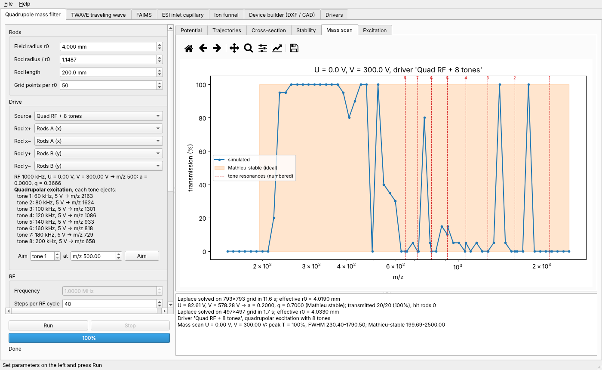 | 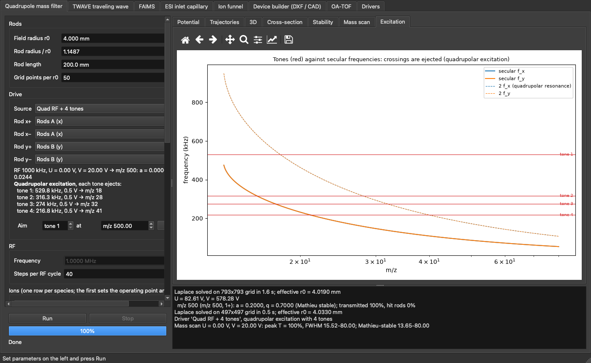 |

| Ion trajectories | Stability diagram |
|---|---|
|  |  |

### TWAVE traveling wave

Board geometry, wave amplitude, speed and shape, gas pressure and temperature, and the ions to separate (each with its K0, plus m/z and charge for diffusion and heating). It runs either a single separation or a sweep over wave speed. Plot tabs: TW field, Arrival times, Ion velocity and Speed sweep.

| Arrival-time distribution | Traveling-wave field |
|---|---|
|  |  |

### FAIMS

Planar cell (gap, length, gas speed and flow profile), waveform (bisinusoidal or rectangular, DV, frequency), gas, and an editable table of species with K0, a2 and a4. It runs either a simulated CV scan or a theoretical dispersion plot. Plot tabs: Waveform, CV spectrum, Ion paths, Alpha and Dispersion.

| CV spectrum | Alpha functions |
|---|---|
| 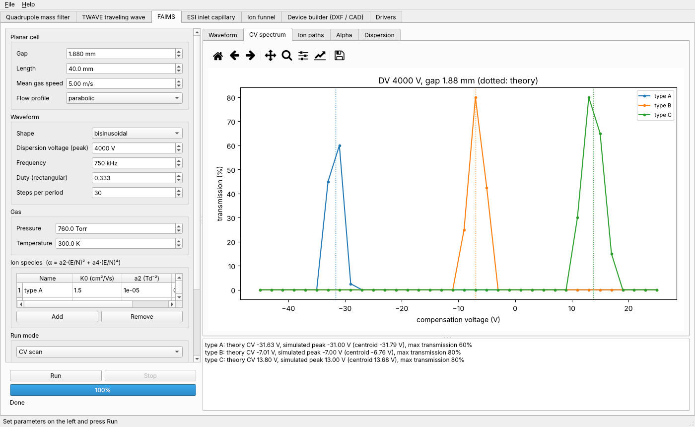 | 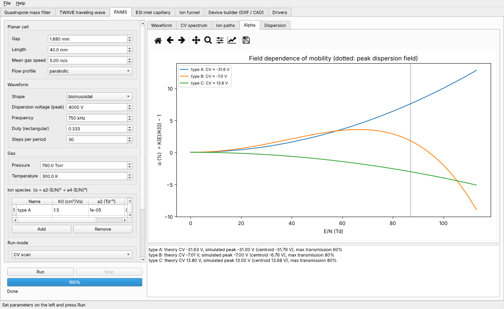 |

### ESI inlet capillary

Spray region (emitter distance, tip radius, spray voltage, where ions leave the droplets), capillary (diameter, length, temperature), first vacuum stage (pressure, skimmer distance and voltage), and an editable ion table (m/z, z, K0). Plot tabs: Flow picture, Gas flow, Ion velocity, Ion energy and Effective temperature.

**Flow picture** shows the gas and the ions moving, from the emitter through the capillary into the first vacuum chamber, in three panels: the spray region, the capillary and the free jet with its barrel and Mach disk. The background is the gas speed; white dots are gas carried by the flow and coloured dots are the ions, one lane per species. The gas speeds up about ten-thousand-fold from the spray to the jet, so each panel plays at its own speed, written in its title (for example *1 s here = 52 µs* in the capillary). **Pause** and **Speed** are above the picture.

| Flow picture: gas and ions from the spray into the vacuum chamber |
|---|
| 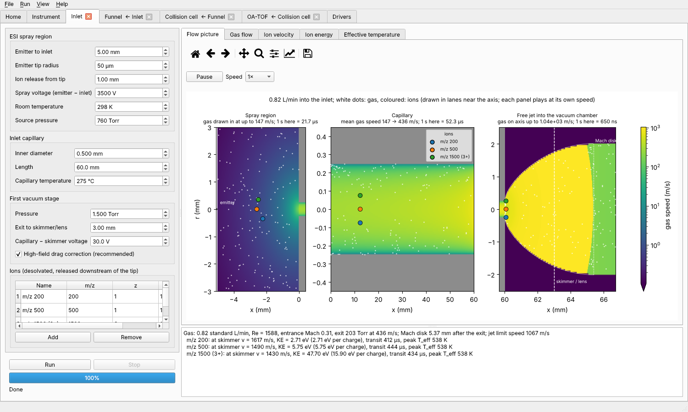 |

| Ion energy | Gas flow |
|---|---|
| 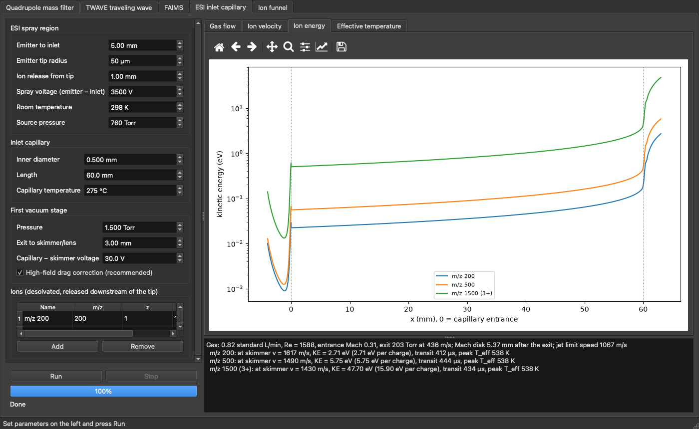 | 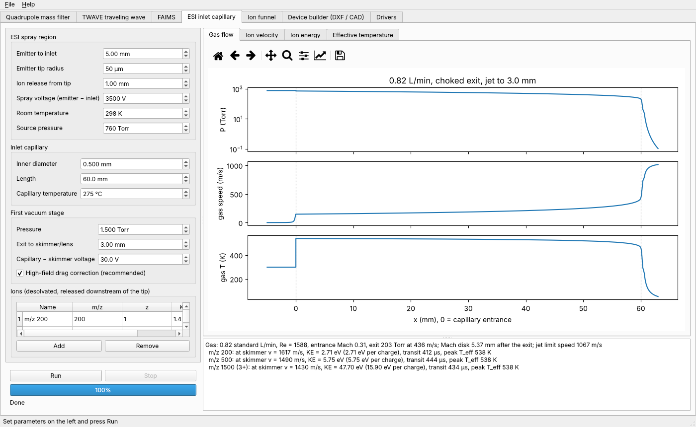 |

### Ion funnel

Pick the funnel type at the top: **Ring funnel** (stacked PCBs), **Planar funnel** (two boards), or **Imported CAD**. Then set the electrics (RF amplitude and frequency, DC gradient, exit plate), gas and ions (the ion table, start radius). It runs either trajectories for every species in the table or transmission against m/z. Plot tabs: Geometry, Potential (DC, RF effective potential and space charge), Trajectories, 3D, Transmission, Exit beam and Gas flow. While the geometry stays the same, the solver is kept, so changing only voltages re-runs in about a second.

* **PCB dielectric.** Ring funnel: each ring is a copper ring around the bore (**Copper ring width**, plated through both faces) on an FR4 board out to the plate diameter (**Board εr**, 4.4 for FR4). Set the width to 0 for all-metal plates. Planar funnel: the strips sit on **Board thickness** of FR4 (0 for strips in free space). Imported CAD: type a permittivity in a body's **Insulator εr** column to make it a board or spacer instead of an electrode. Insulators are drawn in tan, shape the field and stop ions, but carry no voltage.
* **Gas flow.** *Still gas*, *Uniform axial speed*, or *Flow field from gas throughput*. The flow field takes the throughput in slm and an inlet disc on the entrance face (radius 0 = the entrance bore). It solves viscous flow through the open space, pumped out through every open side, and shows it on the **Gas flow** tab. In the ring funnel almost all the gas leaves between the rings, and about 0.2% reaches the exit.
* **Space charge.** Give the **Ion current** in nA (0 = off). The ions are flown several times. Each flight's charge (the current times the time spent near each grid node) sets the space-charge field for the next flight. The log shows the space-charge potential at each step and says if it hasn't settled, which usually means more current than the funnel can carry.

| Ring funnel trajectories (PCB rings, gas flow, 1 nA) | DC, RF effective and space-charge potential |
|---|---|
| 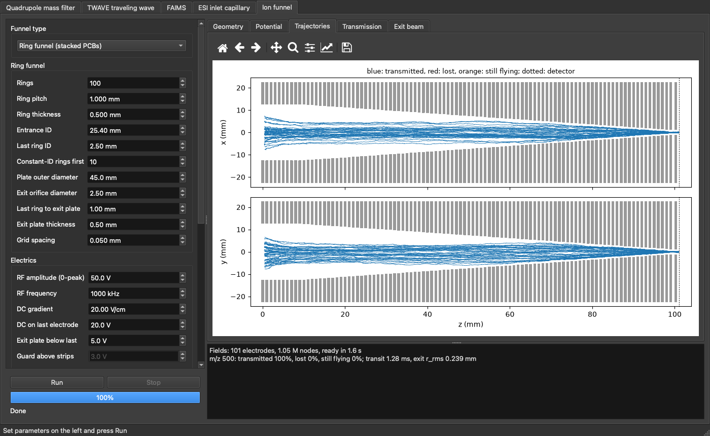 | 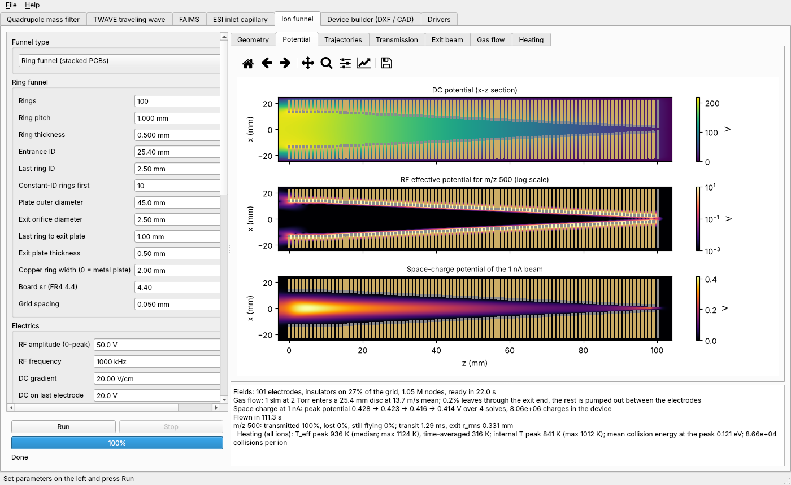 |

| Gas flow through the ring funnel |
|---|
| 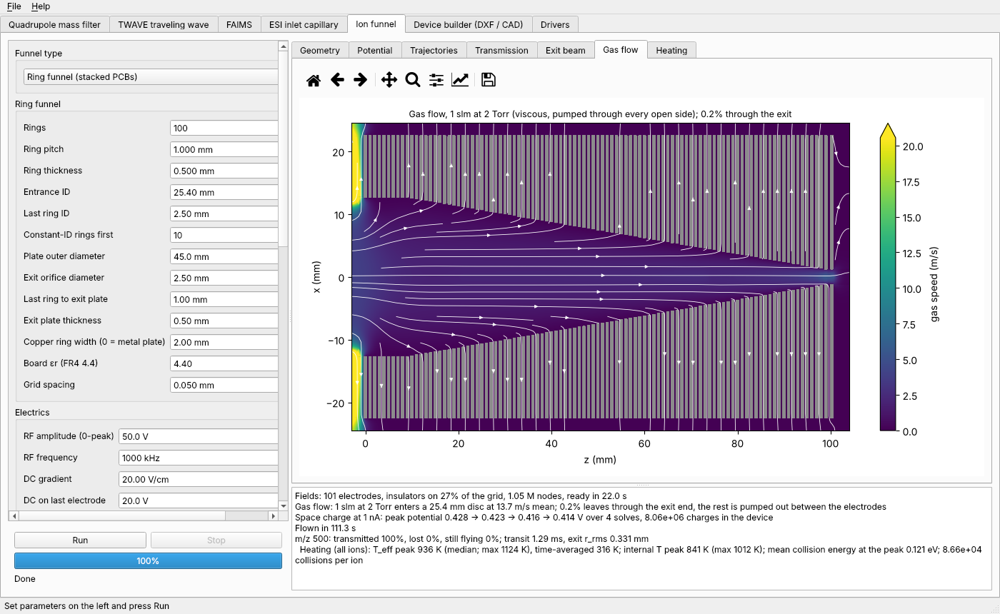 |

**Importing your own funnel (STEP, STL or OBJ):**

1. Choose **Imported CAD** and press **Load STEP / STL / OBJ...**. Every solid body in the file becomes one electrode, named from the file.
2. Say which CAD axis the ions travel along (they enter at its low end). For STL/OBJ, also give the units, because those formats don't store them.
3. The table fills with a standard funnel pattern: bodies sorted along the axis, RF alternating 0°/180°, and a DC ladder from the Electrics box. Tick **Last body is a DC exit plate** if it is. Then edit any DC, RF amplitude or phase by hand. Guards, lenses and grounded parts are just rows with RF set to 0. Boards and spacers get a number in **Insulator εr** (press Auto-assign again afterwards so the pattern skips them).
4. Check the **Geometry** tab (true cross-sections through the start point), set the start point and detector plane, and pick a grid spacing about a third of your smallest electrode gap. The label shows the grid size, and the limit is 40 M nodes.

`examples/geometry/ring_funnel_30.step` is a ready-made 30-ring funnel to try.

| Imported STEP file |
|---|
| 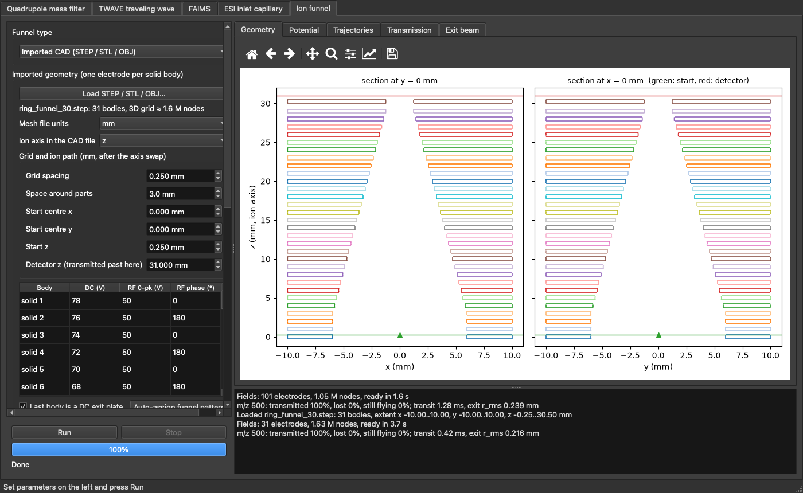 |

### Device builder (DXF / CAD)

The general tab for your own electrodes. Work down the left panel:

1. **Geometry.** Press **Open DXF / STEP / STL…** and pick the file. Under **Read as**, choose *PCB boards* (pads drawn as seen from above, painted on two facing boards a set gap apart, ions travel along the drawing's x), *Axisymmetric half profile* (a half cross-section of rings or lenses: drawing x is the axis, y the radius), *2D cross-section* (rods or plates extruded a set length), or *3D solids* for STEP/STL/OBJ. Units come from the DXF header when it has them.
2. **Electrodes.** Every closed shape becomes an electrode, named by its layer and position (or by a TEXT label inside it). Click a shape on the **Geometry** plot, or a row in the table, to see and edit its DC, RF and TWAVE phase. Ctrl- or Shift-click selects several. Colors show the DC voltage, and RF electrodes are hatched. You can pick a whole layer at once. A number in **Insulator εr** makes a part an insulator (PCB, spacer). For PCB boards, **PCB substrate behind pads** adds an FR4 board of that thickness behind the pads, with a ground plane on its back.
3. **Patterns** for the selected electrodes: **Fixed** (same voltages), **DC gradient** (start and end voltage along the ion axis, with optional RF alternating 0°/180° pad to pad), **TWAVE phases** (pads numbered 1..N along the axis, pads side by side share a phase, pitch measured from the drawing), **Ground**, **Remove from TWAVE**.
4. **Electrics:** RF frequency, and the TWAVE amplitude, speed, number of phases (8 by default) and how many are on. The step time is shown.
5. **Grid:** **Quick** (seconds, for setting up) or **Detailed** (finer, for final numbers), or a custom spacing. **Check geometry on this grid** reports overlapping electrodes, electrodes closer than the grid spacing, parts too thin for the grid, and parts touching the grid edge.
6. **Ions and gas** (the ion table, gas, start point and detector), then **Solve and fly**. Setups save the ion table; older setups load as one species. Changing only voltages re-uses the grid and warm-starts the solve.
7. **Gas flow and space charge:** the same flow field (axisymmetric and 3D devices) and space-charge iteration as the funnel tab.
8. **Ion heating:** gas, how many collisions the ion's internal temperature needs to follow, and optionally an activation energy and pre-factor for a fragmentation / unfolding estimate. Results are in the **Heating** plot.

**Wiring to a driver.** Choose the pattern **Wire to a driver (Drivers tab)**. *All selected to one output* puts the selected electrodes on one output. *TWAVE sequence along the ion axis* numbers the pads 1..N along the path, as the TWAVE pattern does, and puts each on the driver output that carries that phase. Where the driver has RF+ and RF− versions of a phase (the 16-output combiner), they alternate across the path, along it, or RF+ only. Wired electrodes show the driver's values in grey with the output in the **Driver output** column; typing a value over them disconnects them. A saved setup carries a copy of its drivers, so it opens the same on another computer (a driver that differs from yours of the same name comes in as "… (from setup)").

**Save setup…** writes a `.ionsim` file (the drawing path plus every voltage and setting). `examples/geometry/` has four ready setups: `twave_board.ionsim` (48 pads, 8-phase TWAVE with RF guards), `twave_board_combiner.ionsim` (the same board with its pads wired to the 16-output TWAVE/RF combiner), `ring_funnel_profile.ionsim` (a 20-ring funnel drawn as a DXF profile) and `quad_rods.ionsim` (quadrupole rods). `examples/geometry/make_dxf_examples.py` shows how the DXFs are drawn.

| TWAVE board from DXF | Ions surfing the wave |
|---|---|
| 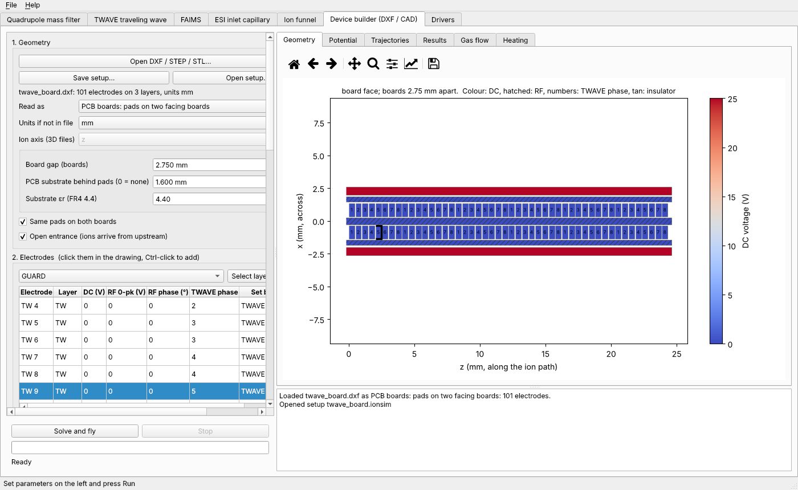 | 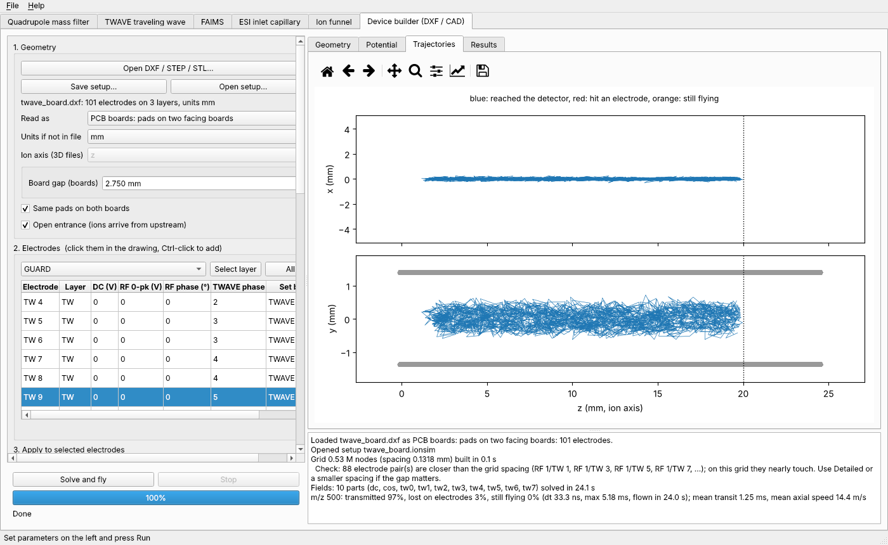 |

| Ring funnel drawn as a DXF profile |
|---|
| 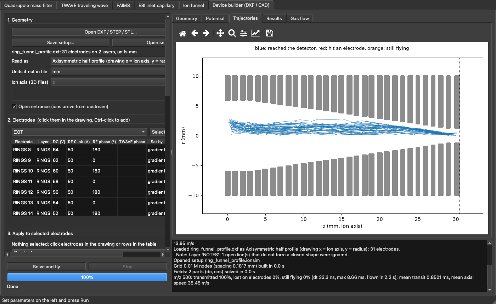 |

In the **Ion funnel** tab, imported CAD bodies are also clickable and colored by voltage, and the same Quick / Detailed grid choice is there.

### OA-TOF

The beam arrives along z through the pusher. A pulse on the pusher plate (and the puller grid) pushes a slice of it up the flight axis, through the acceleration gap, down the drift tube, into the reflectron and back to the detector. Set:

* **Ions:** one row per species (m/z, charge, number); the first row is the reference for scans and tuning. **Positive / Negative ions** flips the sign of every voltage on the tab.
* **Incoming beam:** energy along z and its spread, where the beam sits in the pusher gap, its size, its divergence (and an optional extra thermal spread), and the length of the pusher window. **Ions from** takes the energy, spread, size, divergence and ion mixture from the exit of a quadrupole, ion funnel or Device builder model instead (see Stages above).
* **Pusher and acceleration:** the two gaps, the DC on the pusher plate and puller grid, the pusher and puller pulse amplitudes, the drift-tube voltage, and the pulse rise and fall (10–90 %, linear or RC), width and rate. **Pulse from** takes the timing and voltages from a driver instead (the **OA-TOF pusher and puller** template).
* **Flight tube:** two-stage, single-stage or linear; drift length, reflectron stage depths and voltages, where the detector sits, and the grid transmission. **Suggest reflectron voltages** sets first-order energy focusing for the reference ion, counted from the source's space focus (shown under the button).
* **Detector:** its size, where it sits along z (by default where the reference ion lands), timing jitter and digitizer bin.

**Run modes.** *Single shot* flies every species once and fills **Layout** (ion paths in the whole tube and in the source), **Arrival times** (each peak with its resolution), **Mass spectrum** (calibrated t = t0 + k√(m/z), with zooms on each group of peaks), **Peak width** (each spread alone: beam width, turnaround, detector jitter, then all together), and **Detector** (where ions land). The results box gives flight time, FWHM, resolution, transmission, duty cycle and the highest m/z before the next push overlaps. *Scan a setting* plots resolution and flight time against any voltage, length or the pulse rise. *Tune reflectron* searches the stage 1 and back-plate voltages for the best resolution and copies them in. **Potentials** shows the potential along the flight axis between pulses and with the pulse on, and the pulse edge.

| Two-stage reflectron: ion paths | Mass spectrum, m/z 1000 and 1001 resolved |
|---|---|
| 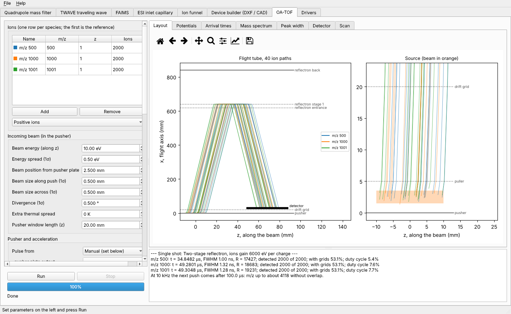 | 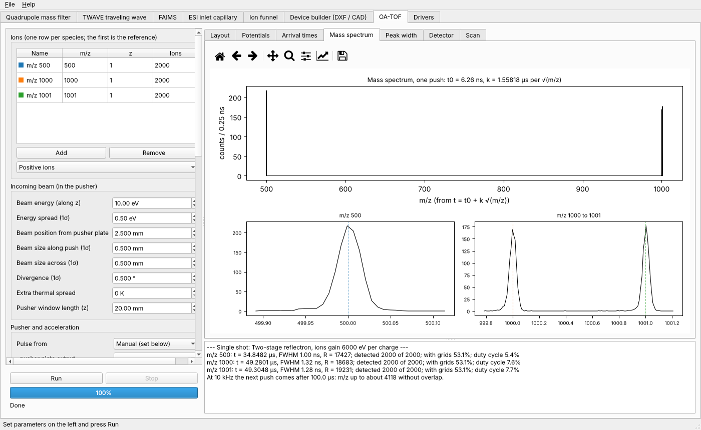 |

| What sets the peak width | Resolution vs reflectron back plate |
|---|---|
| 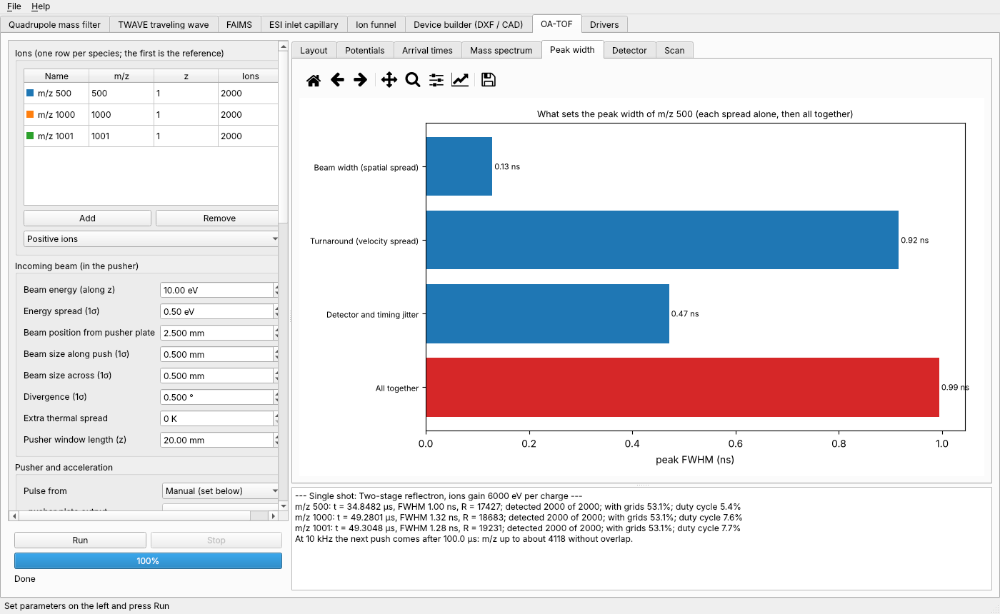 | 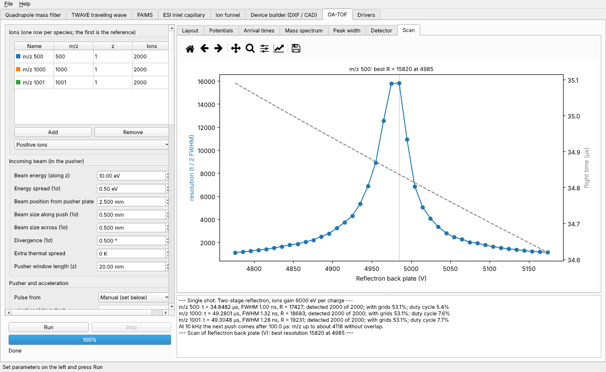 |

### Drivers

The electronics, defined once and used everywhere. Start from a template (**TWAVE/RF combiner (16 outputs)**, **Quad RF + 8 tones** on the RF or dipolar on the x rods, **OA-TOF pusher and puller**, **RF pair**, **DC supply**, or empty), then edit:

* **RF, TWAVE and pulse timing:** RF frequency; number of TWAVE phases, how many are high at once, amplitude, speed at a reference pitch (the step time is pitch / speed) and the edge rise time; pulse rate, delay, width, rise and fall (10–90 %) and edge shape (linear or RC).
* **Outputs:** name, DC, RF amplitude and phase (0 = RF+, 180 = RF−), which TWAVE phase it carries (blank for none), **Tones ×**: +1, −1 or 0, how the excitation tones are added to that output, and **Pulse**: the volts added while the pulse is high.
* **Excitation tones:** frequency, amplitude and phase of each, with an on/off box.

The right side plots the selected outputs' waveforms and the TWAVE gate sequence. Drivers are saved automatically (in `~/.ionsim/drivers.json`) and can be exported and imported as `.iondrv` files; `examples/drivers/` has the combiner, both quad tone drivers and the TOF pusher and puller. A pulsed output wired to an electrode in the Device builder adds one more field part. In a device, a driver costs one field solve per distinct component, not per output: the 16-output combiner on the example board needs 10 (DC, RF and 8 TWAVE phases).

| Combiner outputs (TW1/TW2, RF+ and RF−, 100 ns edges) | TWAVE gate sequence |
|---|---|
| 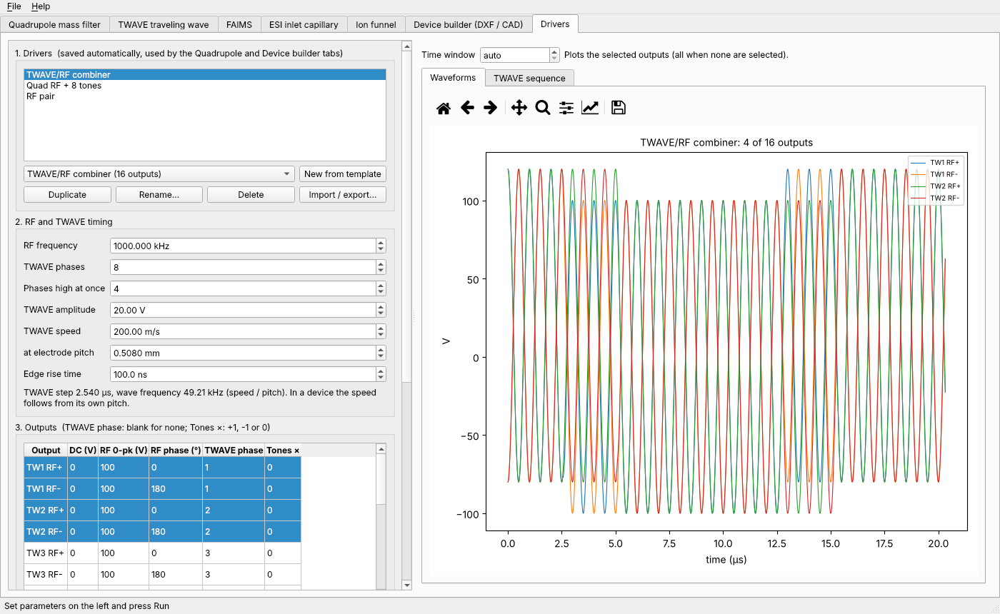 | 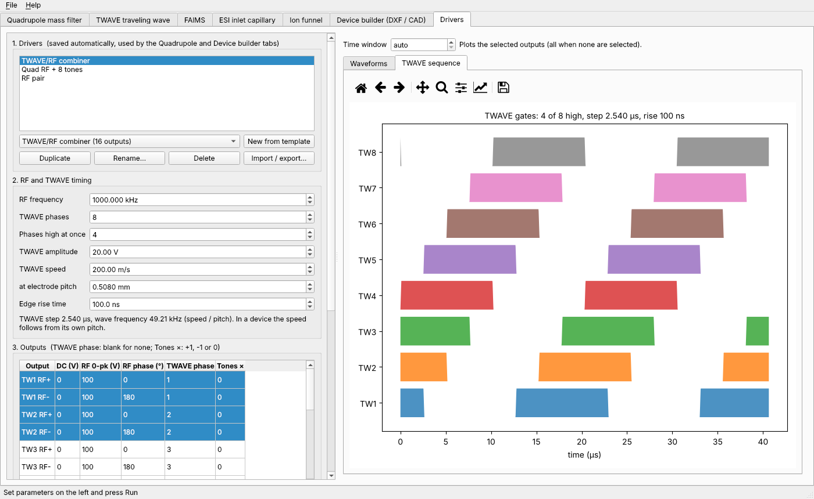 |

#### SPICE and scope waveforms

Section **5. Imported waveforms** of a driver brings in a recorded voltage, and the **Waveform** column of an output picks one of them (**Waveform ×** scales it: a probe or amplifier gain, or −1 to flip it). The output's voltage is then its DC, RF, tones, TWAVE and pulse as before **plus** that waveform, so a waveform can be the whole drive (everything else at 0) or ride on top of the rest. It works wherever drivers work: electrodes wired in the **Device builder**, the **Quadrupole** rods, and the **OA-TOF** pusher and puller.

* **SPICE result…** reads a `.raw` file from ngspice or LTspice (binary or ASCII; LTspice's compressed, double, fastaccess and `.step` files too, where you pick the step), or a text export (LTspice *File > Export data as text*, ngspice `wrdata`). Pick the node voltages you want.
* **Run SPICE netlist…** runs a netlist through **ngspice** (`ngspice -b -r`) or **LTspice** (`LTspice -b`) and reads its result, so a change to the circuit is one click from a new drive. It finds either simulator in its usual install place, or you give the path. The netlist needs a `.tran`. `examples/spice/oa_tof_pusher.cir` is a pusher / puller pulser driving the plates through their wiring inductance, with its result `oa_tof_pusher.raw`.
* **Scope CSV file…** reads a CSV saved on the scope: Rigol's `X,CH1,Start,Increment` layout, the newer `Time(s),CH1(V)` layout, or any table with a time column (`examples/scope/rigol_pusher_ch1.csv`).
* **Capture from Rigol scope…** reads channels straight off a Rigol scope (DS1000Z / MSO1000Z, DS2000, MSO5000, DS/MSO7000, DHO800 / 900 / 1000 / 4000) by SCPI. Over **LAN** give the scope's IP address (the scope's *Utility > IO* page; port 5555, nothing to install). Over **USB** press **Find USB / VISA** and pick the `USB0::0x1AB1::…::INSTR` resource (needs `pyvisa` with `pyvisa-py`, or NI-VISA). Take what is on screen, or the **whole acquisition memory** (the scope is stopped first, and long records are read in pieces), optionally after a **single shot**. The scope's own volts and time base are used (probe ratio included), and **Start the drive at the trigger** drops the pre-trigger part.

Long records are averaged down to 20 000 points (you can keep more), and the waveform is saved inside the driver, so `.iondrv` files and setups carry it. Between samples the voltage is interpolated; by default the record **repeats** with its length as the period (set a longer **Period** to hold the last value until the next repeat, or untick Repeat to hold it for good), and **Delay** shifts it later. The **Imported waveforms** plot shows each as imported and which outputs use it.

Because fields add linearly, a waveform costs one more field part per output that carries it, however long the record. The flight time step follows the waveform: about a fifth of its full swing per step on its steepest edge, never finer than its samples. In the Quadrupole, a waveform's DC and its component at the driver's RF frequency count toward U and V for a/q, so an RF made in SPICE still gets its stability point; set the driver's RF frequency to the waveform's. In the OA-TOF, pick the driver under **Pulse from** and its pusher and puller outputs; the flight follows the waveform step by step until every ion is past the drift grid, and the reflectron suggestion uses the settled push (past the overshoot).

| SPICE pusher and puller on the OA-TOF driver (ringing at the edge) | The OA-TOF pushed by them |
|---|---|
| 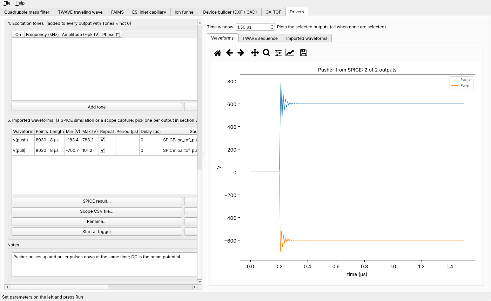 | 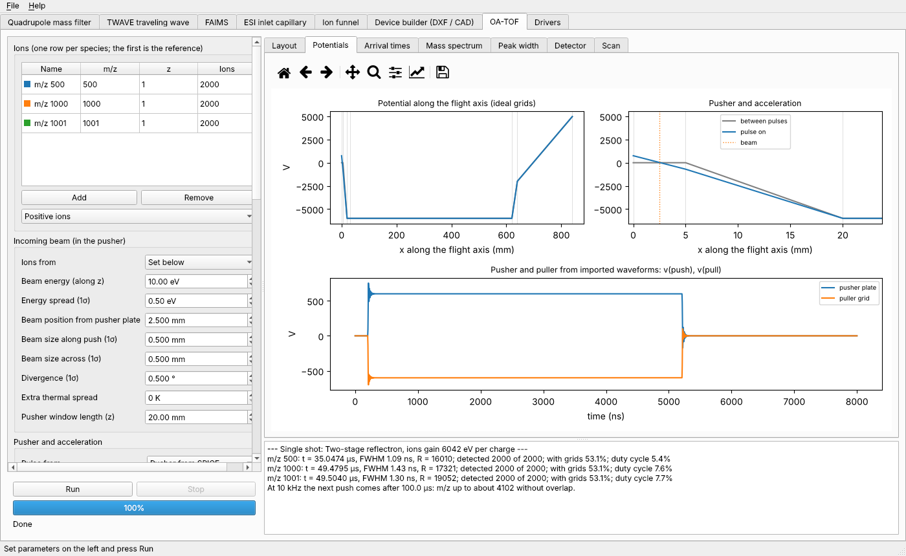 |

| Capture from a Rigol scope |
|---|
| 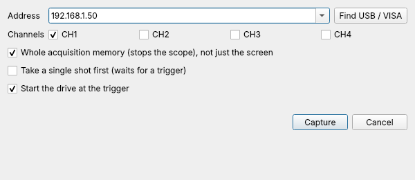 |

### Ion heating

The Ion funnel, Device builder and TWAVE tabs have an **Ion heating** box (on by default). For every ion it reports the effective temperature (how hot the gas collisions are), the internal temperature (which lags by the set number of collisions), the mean centre-of-mass collision energy, collisions per ion and, with an activation energy, the fraction left intact. The **Heating** plot shows the mean and hottest-ion temperatures along the ion axis, where ions fragment, and per-ion peaks.

| Funnel: heating peaks at the exit | TWAVE board with RF on the pads (combiner) |
|---|---|
| 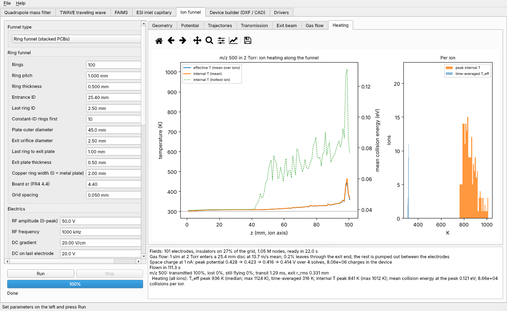 | 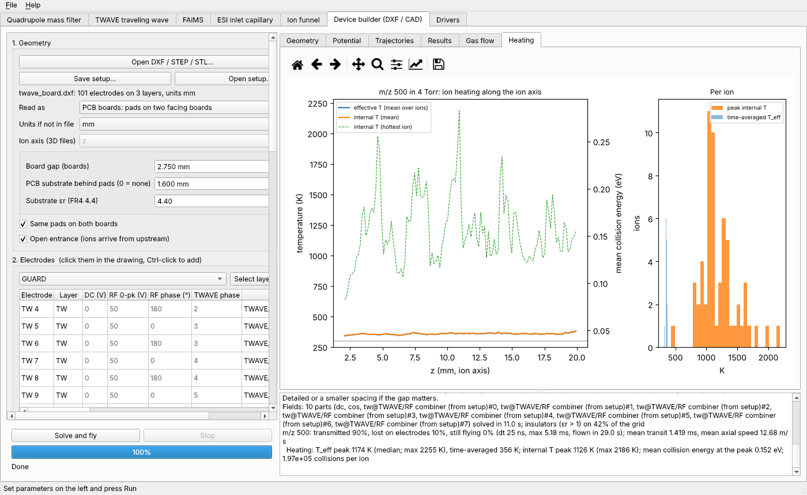 |

<sub>To refresh these screenshots after changing the GUI, run `python docs/make_screenshots.py`.</sub>

---

## Example results

The scripts in `examples/` reproduce these plots without the GUI:

```bash
python examples/quad_demo.py       # ~1 min, writes PNGs 1-4 to out/
python examples/twave_demo.py      # a few min, writes PNGs 5-8 to out/
python examples/faims_demo.py      # ~40 s, writes PNGs 9-11 to out/
python examples/inlet_demo.py      # seconds, writes PNGs 12-14 to out/
python examples/funnel_demo.py     # ~6 min, writes PNGs 15-20 to out/
python examples/tof_demo.py        # seconds, writes PNGs 21-23 to out/
```

### Quadrupole mass filter

| | |
|---|---|
|  |  |
| **Field solve.** Potential of the four round rods (A = +1 V, B = −1 V) inside a grounded can. | **Ion flight.** A stable point transmits 100%. Points just outside the stability region in y or x crash into the rods within a few mm. |
|  |  |
| **Mass scan.** Simulated transmission at a/q = 0.332 against the ideal Mathieu-stable band (m/z 499–506). | **Mathieu stability diagram.** The first stability region, the scan line, and the three operating points from the trajectory plot. |

### TWAVE traveling-wave separation

| | |
|---|---|
|  |  |
| **Traveling wave.** 4 electrodes on / 4 off, stepping one electrode at a time, and the resulting midplane field. | **Surfing vs rolling over.** Mean ion velocity against c/s, with simulation matching the sine-wave theory. |
|  |  |
| **Separation.** K0 = 1.00 and 1.03 cm²/Vs over 1 m at 30 V, 200 m/s, 4 Torr N₂: two-peak resolution Rpp = 2.65. | **Tuning curve.** Two-peak resolution against wave speed over a 0.5 m path. |

### FAIMS

| | |
|---|---|
| 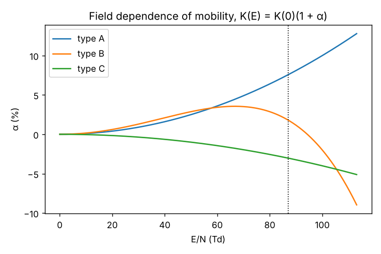 | 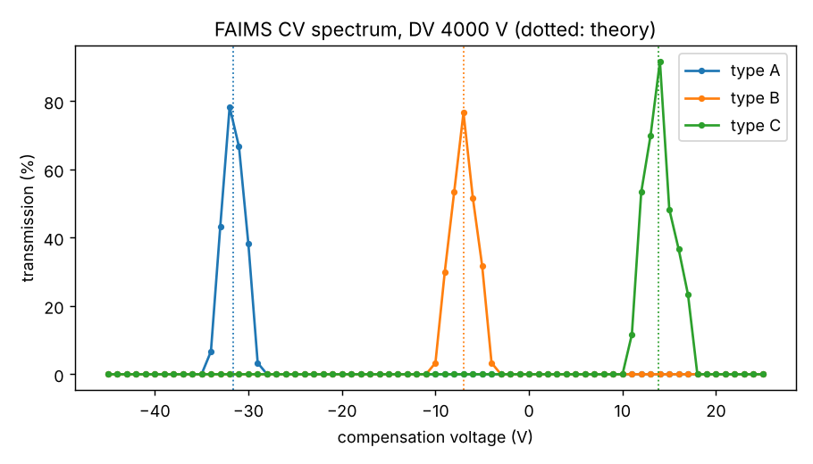 |
| **Alpha functions.** Type A (mobility rises with field), type B (rises then falls) and type C (falls). Dotted line: peak dispersion field, 87 Td. | **CV spectrum.** 4000 V bisinusoidal at 750 kHz across 1.88 mm. Each simulated peak sits on its theoretical CV (dotted). |
| 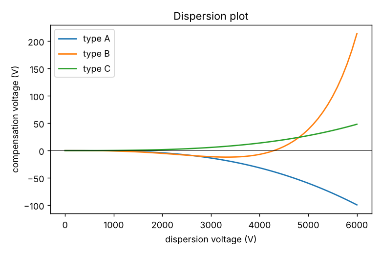 | |
| **Dispersion plot.** CV against DV for the three types. | |

### ESI inlet capillary

| | |
|---|---|
| 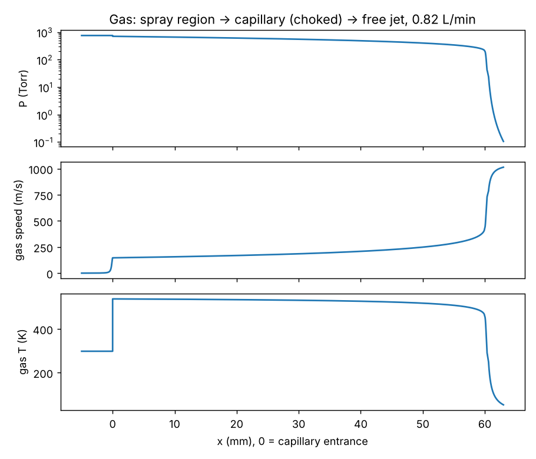 | 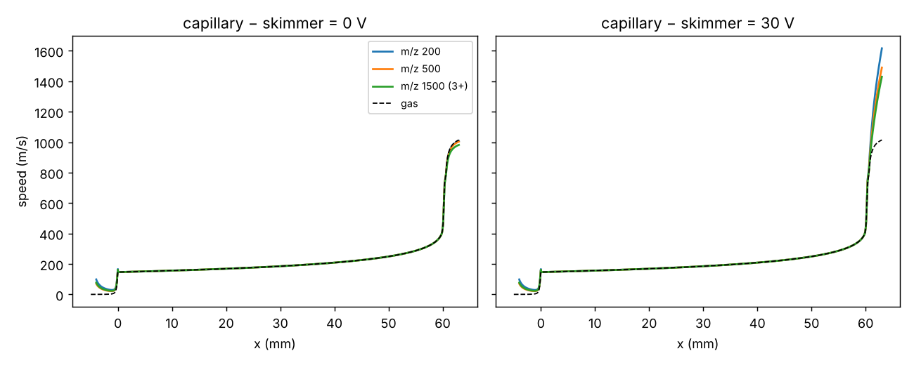 |
| **Gas.** Room air drawn in, Fanno flow down a 0.5 mm × 60 mm capillary at 275 °C (choked at the exit, 203 Torr), then the free jet. | **Ion velocity.** Ions ride the gas through the capillary, then reach the jet speed (left) or overshoot it with 30 V to the skimmer (right). |
| 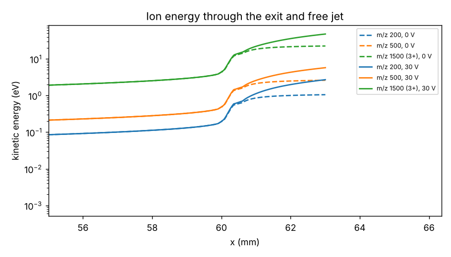 | |
| **Ion energy.** Kinetic energy grows with mass in the jet, and the skimmer voltage adds to it. | |

### Ion funnel

| | |
|---|---|
| 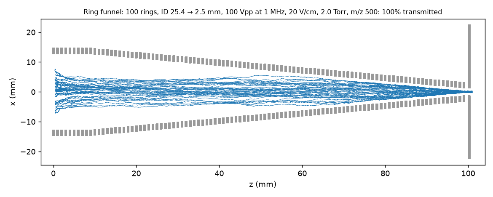 | 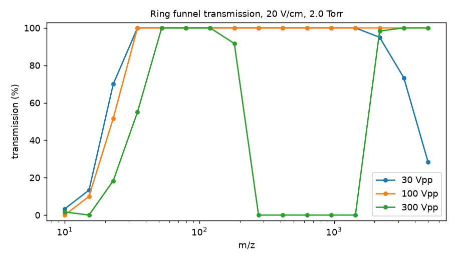 |
| **Ring funnel.** 100 PCB rings (2 mm copper on FR4) tapering from 25.4 to 2.5 mm, 100 Vpp at 1 MHz, 20 V/cm, 2 Torr. Ions entering across 16 mm leave in a 0.24 mm (rms) beam, 1.3 ms later. | **Transmission against m/z.** Low RF (30 Vpp) loses heavy ions onto the tapering rings (weak confinement). High RF (300 Vpp) traps mid-mass ions on axis at the small last rings, where the RF makes an axial barrier. At 100 Vpp everything from m/z 35 to 5000 gets through. |
| 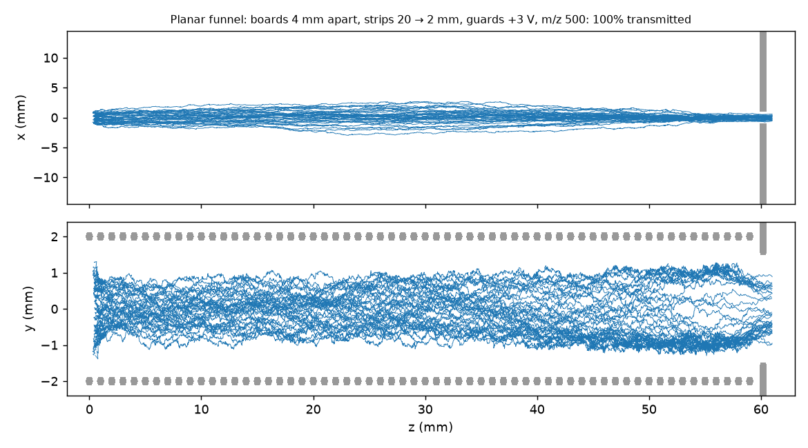 | 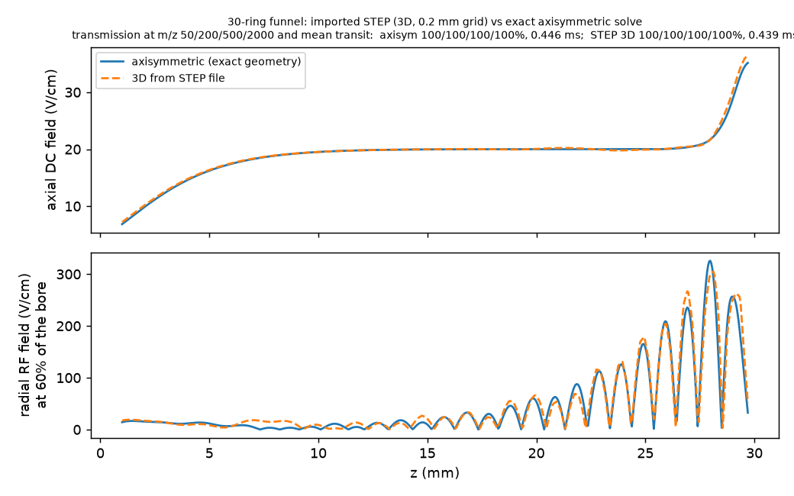 |
| **Planar funnel.** Two FR4 boards 4 mm apart, RF strips shortening from 20 to 2 mm, +3 V DC guards beyond the strip ends. Top: the board face (x); bottom: across the gap (y). | **CAD import check.** A 30-ring funnel written to STEP, imported and solved in 3D, against the exact axisymmetric solve of the same rings: same fields, same transmission. |
| 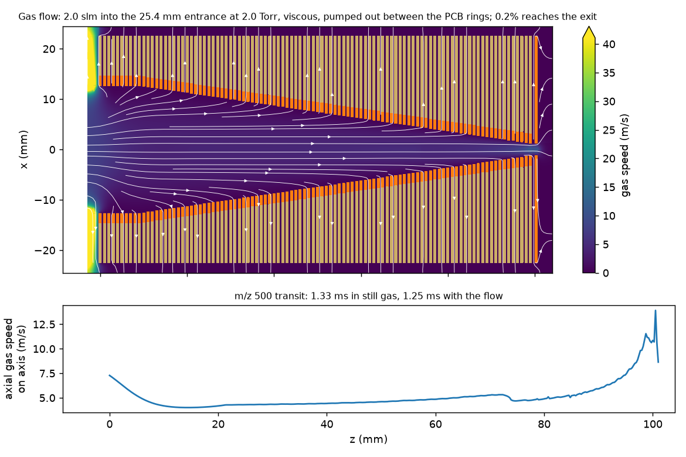 | 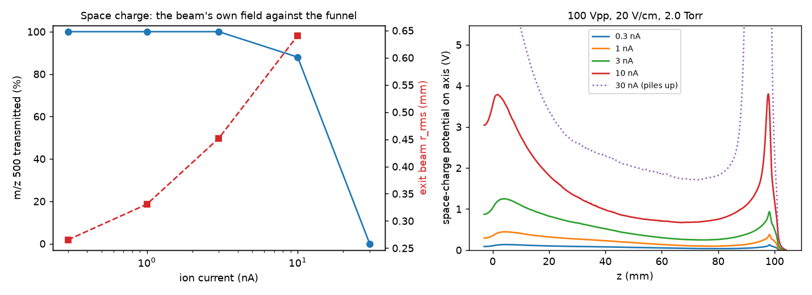 |
| **Gas flow.** 2 slm into the 25.4 mm entrance at 2 Torr. The gas spreads out of the bore and is pumped away between the PCB rings. About 4–5 m/s remains on axis, rising to ~10 m/s near the exit, and 0.2% of the gas gets through. m/z 500 transit drops from 1.33 to 1.25 ms. | **Space charge.** m/z 500 against beam current. Up to 3 nA everything gets through and the beam just gets wider (0.27 → 0.45 mm rms). At 10 nA the 4 V space-charge potential costs 12% of the ions. At 30 nA the charge piles up at the exit, where the RF makes a small axial barrier, and the beam chokes. |

---

## How it works

The quadrupole uses the same approach as SIMION:

| Step | Module | What it does |
|---|---|---|
| Geometry | `ionsim/geometry.py` | Paints electrodes onto a uniform 2D grid (x, y cross-section). `quadrupole_rods(r0, rod_ratio=1.1487)` builds the four rods. The outer edge is a grounded can. |
| Field solve | `ionsim/solver.py` | Sparse direct Laplace solve, once per electrode at 1 V ("basis potentials"). |
| Fields | `ionsim/fields.py` | Superposes basis potentials with time-dependent voltages (SIMION's "fast adjust") and interpolates the field bilinearly. `IdealQuadField` is the analytic hyperbolic field used for checks. |
| Flight | `ionsim/integrator.py` | Vectorised RK4 over thousands of ions, with electrode hit detection and staggered birth times to sample the RF phase. |
| Theory | `ionsim/mathieu.py` | a/q from U, V, m, r0 and f, plus a Floquet-based stability test (no lookup tables). |

Rods A (on x) sit at +(U + V cos Ωt) and rods B (on y) at −(U + V cos Ωt), with V zero-to-peak, so

a = 8eU / (m r0² Ω²),  q = 4eV / (m r0² Ω²)

### TWAVE traveling wave (`ionsim/twave.py`)

* **Boards and electrodes:** two boards `gap` apart, with TW electrodes at `pitch` and `width`, 8 per wavelength, 4 on / 4 off, stepped one electrode every pitch/speed. The field between the boards comes from an exact Fourier (Laplace) solution of the periodic electrode pattern, with a linear ramp across the insulating gaps.
* **Ion motion:** 4 Torr is the mobility regime, so ions follow dz = K·E dt + √(2D dt)·N(0,1). K comes from K0, pressure and temperature, and D from the Einstein relation.

### FAIMS (`ionsim/faims.py`)

* **Field:** uniform across the gap, E(t) = (DV·f(t) + CV)/gap. f(t) is the bisinusoidal waveform (2 sin ωt + sin(2ωt − π/2))/3, or a rectangular one with a set duty cycle, with peak +1 and zero mean.
* **Mobility:** K(E) = K(0)·(1 + a2 (E/N)² + a4 (E/N)⁴) with E/N in Td, scaled to the gas density.
* **Ion motion:** across the gap dy = K(E)·E dt + √(2D dt)·N(0,1), and along it dx = u_gas(y) dt with a parabolic or plug flow profile. Ions that touch a plate are lost.
* **Theory:** the compensation voltage is where the waveform-averaged drift ⟨K(E)E⟩ is zero, found by root search (`cv_theory`).

### ESI inlet capillary (`ionsim/inlet.py`)

Everything is 1D along the axis, from the emitter to the skimmer.

* **Spray region:** a hyperbolic-tip field from the emitter, normalised to the spray voltage, and room air drawn into the capillary as a sink flow. Ions start already desolvated, a set distance downstream of the tip.
* **Capillary:** compressible flow with wall friction (Fanno flow), choked at the exit, with the friction factor from the Reynolds number. The gas is taken to be at the capillary temperature from the entrance on.
* **Free jet:** Ashkenas–Sherman centreline Mach number for an under-expanded sonic jet, up to the Mach disk at 0.67·D·√(P0/Pb).
* **Flow picture (off the axis):** for the picture only, the axis results are spread across the flow. In the spray region the gas flows radially into the entrance (sink flow). In the capillary the 1D mean speed gets a parabolic profile (laminar) or a 1/7-power profile (turbulent), with the same mean. The jet flows radially from the exit, with the axis speed at the same distance, inside a barrel that widens to about 0.75·x_M across at the Mach disk; past it the subsonic core slows over a few x_M, and the background gas outside is still. The ions fly on the axis tables; they are drawn in lanes near the axis.
* **Ions:** dv/dt = (u_gas − v)/τ + (q/m)E with τ = mK/q and K scaled with gas density. An exponential step keeps this stable from about 1 ns at 1 atm to the slow relaxation in the jet. A hard-sphere correction stops the drift growing linearly at high E/N. The outputs are speed, kinetic energy and the Wannier effective temperature, T_eff = T + M_gas (v − u)²/3k.

### Ion funnel (`ionsim/funnel.py`)

* **Geometry:** `RingFunnel` (stacked PCB rings, constant ID first and then a linear taper, with an exit plate), `PlanarFunnel` (two FR4 boards of strips across the ion path, DC guards beyond the strip ends, an exit slit), or `CadFunnel` (any bodies from `ionsim/cad.py`, some of them insulators).
* **Dielectrics (`ionsim/laplace.py`, `ionsim/gridtools.py`):** each grid node carries a relative permittivity, and every link weight is scaled by the harmonic mean of its two ends (the series capacitance of two half cells). The same matrix then solves ∇·(ε∇φ) = −ρ. Links into an electrode take the permittivity of the free side. Insulator nodes aren't fixed in the solve, but ions that reach them stop.
* **Gas flow (`ionsim/gasflow.py`):** viscous, incompressible flow in the lubrication (local Poiseuille) approximation: u = −(k/μ)∇p with ∇·(k∇p) = 0 and k = c·δ(2L − δ). Here δ is the distance to the nearest wall and L the local channel half-width, found by following δ uphill to the channel's centre ridge. With c = ½ in slits and ¼ in round bores, that is the exact Poiseuille profile and conductance for straight channels, so a funnel's narrow ring gaps pass far less gas than their area suggests. Gas enters through a disc on the entrance face, every other open side is pumped, and the result is scaled to the throughput (μ drops out). Ions read u at their mid-step position.
* **Space charge (`ionsim/spacecharge.py`):** a steady beam of current I is represented by the N flown ions, each standing for I/N. The charge near each node is I/N times the total time ions spend there, deposited cloud-in-cell during the flight. Poisson is solved for it with every electrode at 0 V (same matrix and factorization as the applied field), its field is added to the applied field, and the ions are flown again. Four passes with 0.4 under-relaxation settle well-behaved beams. The run reports when the potential hasn't settled.
* **Electrics:** each electrode gets a DC voltage, an RF amplitude and an RF phase. Laplace is linear, so three solves (DC, cos and sin parts, `ionsim/laplace.py`) give the field at any time for any number of electrodes. Alternating 0°/180° RF needs only two.
* **Fields:** rings are solved on an axisymmetric r–z grid (`ionsim/axisym.py`, finite volumes with face-radius weights, exact symmetry). Everything else uses a 3D voxel grid (`ionsim/grid3d.py`). 2D grids are solved by direct sparse LU: the factorization is kept, so a re-solve takes well under a second. 3D grids use algebraic multigrid (PyAMG) at a relative tolerance of 1e-7, warm-started from the previous solution when only voltages change: 1 M nodes take about 1–2 s, 8 M about 10 s. The entrance face is open (zero normal field), as if an inlet sat in front, rather than a grounded wall.
* **CAD import (`ionsim/cad.py`):** STEP/IGES/BREP are read with gmsh (OpenCASCADE) and meshed. STL/OBJ/PLY are read with trimesh, plus a small OBJ reader that keeps named objects. Meshes are voxelised by ray parity along z (fills closed solids, holes included). A surface shell sampled at h/2 is added only where a part is too thin to fill, so 35 µm PCB copper still becomes electrode.
* **Ion motion (`ionsim/gasflight.py`):** Langevin dynamics. The field (sampled at the middle of each step, which keeps RF motion accurate at 30 steps per cycle even in vacuum), a drag that relaxes the velocity to the gas velocity with τ = mK/q, and thermal kicks. Over each step the Ornstein–Uhlenbeck equations are integrated exactly, with correlated position and velocity noise. That stays stable and correct both when τ is longer than the RF period (RF inertia, the effective potential) and when it is far shorter (pure mobility drift).
* **Effective potential (plots):** U = q⟨E²⟩ / (2m(ω² + 1/τ²)), the RF pseudopotential reduced by gas damping.

### Device builder (`ionsim/dxf.py`, `ionsim/device.py`)

* **DXF reading:** ezdxf reads polylines, circles, arcs, splines, ellipses, solids and hatches (blocks are exploded). Arcs and curves are flattened to polygons. Loose LINE and ARC pieces are joined end to end into closed loops, and a loop inside another on the same layer becomes a hole. Open lines that never close are reported, not used.
* **Electrode model:** each electrode has a DC voltage, an RF amplitude and phase, and an optional TWAVE phase number. Laplace is linear, so the field is the sum of one solve for DC, two for RF (cos and sin) and one per TWAVE phase. TWAVE phase k is on while ((k − step) mod N) < n_on, and the step advances every pitch/speed.
* **Grids:** flat boards and 3D CAD use the 3D voxel grid; profiles use the axisymmetric grid; 2D cross-sections use a planar 2D grid. Interiors are painted first, then outlines, so neighbors never steal each other's nodes.
* **Flight:** the same Langevin integrator as the funnel. The time step is picked from the RF period, the TWAVE step time and the device length, and flight time from the expected drift.

### Collision cell (`ionsim/collisions.py`)

* **Collisions:** after each RK4 step each ion meets a gas molecule with P = 1 − exp(−n σ g dt), where g is its speed relative to a molecule drawn from the thermal gas. A hit is an elastic hard-sphere collision: in the centre-of-mass frame the relative velocity keeps its size and turns to a random direction. This one-collision-at-a-time model fits 10⁻⁴ to 10⁻¹ Torr, where the smooth drag of the funnel model (many collisions per step) no longer holds.
* **Cross section:** from the ion's reduced mobility, Mason–Schamp: Ω = 3ze / (16 N₀ K₀) · √(2π / μkT). The same K0 that sets the drift in a funnel sets the collision rate here.
* **Drag field:** a uniform E_z added to the rod field.

### OA-TOF (`ionsim/tof.py`)

* **Geometry:** planes along the flight axis x: pusher plate, puller grid, drift grid, detector, reflectron entrance, stage 1 grid and back plate. Every gap is bounded by ideal grids, so its field is uniform along x and only changes in time (the pulse). Ions keep their z and y velocity, which sets the drift angle and where they land on the detector.
* **Flight:** inside a gap the motion is a parabola, so the time to the next grid is the root of a quadratic and the flight is exact gap by gap. While the pulse is rising or falling the gap fields are held for short steps at their midpoint values (second order in the step). A run of 10 000 ions takes well under a second.
* **Beam:** positions are Gaussian across the push direction and uniform along the pusher window; the push-direction velocity comes from the divergence (v_x = v_z tan θ) plus an optional thermal spread. Turnaround time is therefore 2 m v_x / qE.
* **Results:** resolution = t / 2·FWHM, with the detector jitter added before the FWHM; grid transmission is applied per crossing as a weight. Duty cycle = window / (v_z · period) times the detected fraction.
* **Reflectron suggestion:** the source's first-order space focus D (Wiley–McLaren, two-field source) is where the reflectron must refocus from. Single-stage: the turning depth is a quarter of the field-free path from D to the detector. Two-stage: stage 1 takes 2/3 of the energy and the back plate is set so the flight time is stationary in energy.

### Drivers (`ionsim/drivers.py`)

* **Waveform:** each output is V(t) = DC + RF cos(2πf t + φ) + (Tones ×) Σ A_k cos(2πf_k t + φ_k) + A_TW · gate_p(t) + A_pulse · pulse(t). Phase p's gate is high while ((p − step) mod N) < n_on, the step advances every pitch / speed, and each edge ramps linearly over the rise time.
* **Imported waveforms (`ionsim/waveforms.py`, `ionsim/scope.py`):** a waveform is a sampled record v(t), linearly interpolated and repeated with its period. It adds Waveform × v(t) to its output and one field part per output that carries it, whose weight at time t is v(t). SPICE raw files are read directly (header, then float64 rows for ngspice, float64 time and float32 values for LTspice, absolute value of LTspice's negative compressed times, stepped runs split where time restarts). Rigol captures use `:WAV:PRE?` and `:WAV:DATA?`: volts = (code − y-origin − y-reference) · y-increment, t = (i − x-reference) · x-increment + x-origin.
* **Field parts:** a device is solved once per distinct component: DC, cos and sin of each frequency in use, and each TWAVE phase of each driver. Outputs that share a component share its solve, so 16 outputs or 8 tones stay cheap. Electrodes not wired to a driver use the device's own RF and TWAVE settings as before.
* **Quadrupole:** the rods are four separate electrodes, each driven by its output's waveform. For a/q the tab uses U = (DC_x − DC_y)/2 and V = |RF_x − RF_y|/2 (phasors, averaged over each rod pair). Secular frequencies come from the Floquet characteristic exponent β, f = β f_RF / 2, in x from (a, q) and in y from (−a, −q).

### Ion heating (`ionsim/heating.py`)

* **Effective temperature (two-temperature / Wannier theory):** T_eff = T + M_gas w²/3k, where w is the field-driven part of the ion's velocity relative to the gas. It is integrated along each ion's path with the same exact drag step as the flight, minus the thermal noise, so it covers DC drift (w = KE), RF oscillation, TWAVE and launch energy. Mean collision energy (centre of mass) = 3/2 k T_eff.
* **Collision rate:** ν = NΩ·⟨v_rel⟩, with NΩ from the mobility (Mason–Schamp, so no separate cross section is needed) and ⟨v_rel⟩ at T_eff.
* **Internal temperature:** dT_int/dt = (T_eff − T_int)·ν / n_eq, with n_eq the collisions the ion needs to equilibrate.
* **Fragmentation / unfolding estimate:** a first-order Arrhenius rate k = A exp(−Ea / k T_int) integrated along the path; survival = exp(−∫k dt). Where the rate piles up is the shaded "where ions fragment" curve.
* **TWAVE tab:** overdamped, so w = K E at every step.

### Default parameters

| Quadrupole (`examples/quad_demo.py`) | TWAVE (`examples/twave_demo.py`) |
|---|---|
| r0 = 4.0 mm, rod radius = 1.1487 r0 | pitch 0.508 mm, width 0.432 mm, gap 2.75 mm |
| f = 1.0 MHz, m/z 500, rod length 200 mm | 30 V, 200 m/s |
| 5 eV axial energy | 4 Torr N₂, 300 K |
| grid spacing r0/80, 40 RK4 steps per RF cycle | K0 = 1.00 and 1.03 cm²/Vs over 1 m |

| FAIMS (`examples/faims_demo.py`) | ESI inlet (`examples/inlet_demo.py`) |
|---|---|
| planar, gap 1.88 mm, 40 mm long, 5 m/s parabolic flow | emitter 5 mm from the inlet at 3500 V, ions released 1 mm from the tip |
| 4000 V bisinusoidal at 750 kHz (87 Td) | capillary 0.5 mm × 60 mm at 275 °C |
| N₂ at 760 Torr, 300 K | 1.5 Torr first stage, skimmer 3 mm away at 30 V |
| example type A / B / C species | m/z 200 (1+), 500 (1+), 1500 (3+) |

| Ring funnel (`examples/funnel_demo.py`) | Planar funnel |
|---|---|
| 100 rings, 1 mm pitch, 0.5 mm thick, 45 mm plates | 60 strips per board, 1 mm pitch, 0.5 mm wide |
| 2 mm copper ring around the bore on FR4 (εr 4.4) | strips on 1.6 mm FR4 (εr 4.4) |
| ID 25.4 mm (10 rings) tapering to 2.5 mm, 2.5 mm exit orifice | boards 4 mm apart, strips 20 → 2 mm, 2 × 3 mm exit slit |
| 100 Vpp at 1 MHz, 20 V/cm, last ring 20 V, exit plate 15 V | same electrics, guards +3 V above the local strip DC |
| 2 Torr N₂, 300 K, m/z 500 with K0 = 1.0 cm²/Vs, grid 0.05 mm | grid 0.2 mm (1.95 M nodes) |

---

## Validation

**Quadrupole**
* Grid field vs ideal hyperbolic: 0.99 near the axis (rod staircasing). This is expressed as an effective r0 = 4.019 mm and used for a/q.
* Operating points: (a = 0.20, q = 0.70) transmits 100%. (0.26, 0.70) and (0, 0.95) transmit 0%, matching Mathieu.
* Mass scan at a/q = 0.332: the Mathieu-stable band is 499–506. The simulated FWHM is 498–505, with soft edges from the finite number of RF cycles (~145), as expected for a real filter.

**TWAVE**
* For an ideal sine wave the mean velocity must follow theory: s for surfing (c ≥ s) and s − √(s² − c²) for rolling over, where c = K·Emax. The simulation matches to within 0.017 of the wave speed.
* K0 = 1.00 vs 1.03 cm²/Vs over 1 m gives resolving powers of 60 / 63 and a two-peak resolution of Rpp = 2.65.

**FAIMS**
* Simulated CV peaks land on the ⟨K(E)E⟩ = 0 theory: type A −31.59 vs −31.63 V, type B −6.99 vs −7.01 V, type C 13.94 vs 13.80 V.

**ESI inlet**
* Gas: 0.82 standard L/min at Re ≈ 1600 (laminar), with an entrance Mach number of 0.31 and a choked exit at 203 Torr.
* Heavy-ion limit: with no field in the jet, a light ion reaches 0.996 of the gas speed, and its energy matches ½·m·u_gas² (0.53 eV for m/z 100). Heavy ions lag the gas (0.95 for m/z 5000).
* Ion energy at the skimmer grows with mass: 1.05, 2.61 and 22.5 eV for m/z 200, 500 and 1500 (3+) with no field, or 2.7, 5.8 and 47.7 eV with 30 V.

**Ion funnel**
* Langevin flight in a uniform field: drift speed = K·E within 0.6%, and spread = √(2Dt) within the 2% statistical error. This holds both with time steps 20× shorter than τ and 20× longer.
* Axisymmetric solver vs the exact coaxial-cylinder potential: 5×10⁻⁶ V error (of 1 V), 0.02% field error.
* 3D solver and voxeliser vs concentric spheres: potential error 1.1% at a 0.25 mm grid and 0.5% at 0.125 mm (first order, as expected for voxels), and the voxelised sphere volume is within 1%.
* STEP import end to end: a 30-ring funnel written to STEP, imported, voxelised and solved in 3D matches the exact axisymmetric solve. The DC field agrees within 0.4% mid-funnel and within 2% at the ends (where the 3D box and the cylinder enclosure differ), and the RF field converges with grid spacing (16–17% → 7–9% rms going from 0.2 to 0.1 mm). Transmission at m/z 50–2000 is identical (100%), and transit times agree within 7%.
* Solver speed: the 30-ring STEP funnel at a 0.2 mm grid went from 19.5 s to 2.9 s with the 1e-7 tolerance, and a warm-started re-solve after a voltage change takes 1.5 s, with no visible change in the fields.
* Dielectric: a slab of εr 4 between parallel plates gives exactly the series-capacitor potential (to 1e-4 V of 100 V).
* Space charge: a uniformly charged beam in a grounded tube gives the analytic axis potential ρa²/4ε₀·(1 + 2 ln R/a) within 0.6%, on both the axisymmetric and the 3D grid.
* Gas flow: a pipe gives the Poiseuille profile 2(1 − r²/R²)·ū within ~3%. Earlier, an inviscid (potential flow) version sent 99.99999% of the gas out between the rings, because it ignores how much viscosity holds back flow through narrow gaps. That's why the lubrication model is used.
* PCB rings vs all-metal plates (100 Vpp, m/z 500): both transmit 100%, and transit is 1.33 vs 1.29 ms. The FR4 between the copper rings slightly weakens the axial DC field.
* Physics: with 140 Vpp and a 2.0 mm final ID, m/z 500 ions stall on axis between the last two rings. The pseudopotential calculation shows a 1.1 V axial barrier there against a 1.5 V/mm push. That's the known small-ID trapping at funnel exits, and the reason the defaults use 2.5 mm and 100 Vpp.

**OA-TOF**
* Flight time of an ion starting at rest with an instant pulse matches the closed form (uniform acceleration in each gap, then drift) to 1e-9.
* Linear TOF with only a spatial spread: the best detector distance from a scan is 86.0 mm, the Wiley–McLaren space focus 86.0 mm.
* Single-stage reflectron: the suggested back plate (quarter-depth rule) is within 20 V (1.3 %) of the best voltage from a scan.
* Defaults (6 kV, 600 mm drift, two-stage reflectron, 10 eV beam 0.5 mm wide with 0.5° divergence, 10 ns rise, 0.2 ns jitter): resolution about 17 000 for m/z 500 and 1000, m/z 1000 and 1001 baseline resolved, set by the turnaround time (0.9 ns) and detector jitter (0.5 ns); the beam width alone gives 0.1 ns once the reflectron refocuses the space focus. The automatic tune lands within 0.5 % of the suggested voltages.

**Drivers**
* TWAVE gates: 4 of 8 phases high at every step, phase 1 high at step 0 and off at step 1, stepping one phase per step (smoke test).
* The example TWAVE board with its 96 pads wired to the 16-output combiner (RF off on the pads) transmits 97% at 14.1 m/s, the same as with the board's own TWAVE settings (97%, 14.3 m/s).
* Quadrupole tone excitation (r0 = 4 mm, 300 V RF at 1 MHz, U = 0, m/z 500 at q = 0.37): a 15 V tone added to the RF at twice the secular frequency (263 kHz) ejects m/z 461–550, with two weaker side resonances near m/z 214 and 271; everything else stable passes at 100%. A 1 V dipolar tone at the secular frequency (131 kHz) ejects m/z 500 when on resonance and lets it through 3% off resonance, the expected narrow dipolar line.

**SPICE and scope waveforms**
* ngspice binary and ASCII raw, ngspice `wrdata`, and LTspice raw files (UTF-16 header, float32 values, compressed times, fastaccess, two `.step` runs) read back the values written to 1e-6 (smoke test).
* A quadrupole whose RF comes from a sampled 1 MHz cosine on an imported waveform flies the same ion paths as the driver's own RF, to better than 0.01 µm.
* OA-TOF: the ideal 10 ns pulse given as a pusher and puller waveform reproduces the analytic flight times to 1.4e-7. The SPICE pusher in `examples/spice` (15 Ω pulser, 150 nH wiring, 40 pF plate: about 30 % overshoot ringing at ~65 MHz) gives m/z 500 a resolution of about 15 600 against 15 900 for the ideal pulse in the same run.
* Scope capture against a simulated Rigol on a local socket: screen and 600 000-point memory reads (in 250 000-point pieces), 8-bit BYTE and 12-bit DHO WORD formats, volts within half a code step.

**Ion heating**
* DC drift field (4 Torr N₂, m/z 500, K0 = 1): T_eff 301.9 K vs 302.0 K from theory at 20 V/cm, and 494 K vs 496 K at 200 V/cm.
* Uniform RF field (2 Torr, 50 V/cm, 1 MHz, ωτ = 1.4): time-averaged T_eff 308.53 K vs 308.59 K from the damped-oscillator result.
* Arrhenius check: survival 4.8% against exp(−k t) = 4.5% at the final internal temperature (the estimate must sit a little above, since T_int starts cold).
* Collision rate for m/z 500, K0 = 1 at 4 Torr: 1.3 × 10⁸ /s.
* Ring funnel defaults (100 Vpp, 2 Torr): ions stay within 10–20 K of the gas through most of the funnel; effective temperatures reach ~870 K for a few µs at the exit plate, where the 5 V exit step drives them hard. A 30 V TWAVE at 200 m/s, 4 Torr: ~325 K peak. The example board wired to the combiner with 50 V RF on the TWAVE pads (`twave_board_combiner.ionsim`): 90% transmitted, and the median ion's internal temperature peaks near 1100 K, because ions sample the strong RF close to the pads. RF on the pads heats far more than the wave itself.

**Device builder**
* Quadrupole rods from a DXF (2D cross-section): 100% transmitted at (a = 0.20, q = 0.70) and 0% at (0.26, 0.70) and (0, 0.95), as the Mathieu diagram says. Before the midpoint field sampling, the gas-flight integrator lost about 60% at the stable point in vacuum at 30 steps per cycle.
* Ring funnel drawn as a DXF profile (axisymmetric): 100% of m/z 500 transmitted at 2 Torr.
* TWAVE board from DXF (48 pads, 0.508 mm pitch, 8 phases, 4 on, 20 V, 150 m/s, RF guard strips): 97–98% transmitted, mean ion speed 14.3–14.4 m/s against 13.4 m/s from the sine-wave roll-over theory. The real wave is square rather than sine, so it pushes slightly harder. Quick grid: 0.53 M nodes, 10 field parts solved in 23 s, re-solve after a voltage change 4 s.

---

## Limits and roadmap

**Quadrupole, not modelled yet**
* 2D field only: no fringe fields at the rod entrance and exit (a 3D grid is the obvious next field upgrade).
* No space charge. The axial drag field is uniform (no segmented-rod or auxiliary-electrode solve yet).
* Collisions are elastic hard spheres with a cross section from K0 (Mason–Schamp): no ion–induced-dipole (Langevin) capture, and no internal energy taken up in a collision. A run at 0.5 Torr N₂ settles at the gas temperature (301 K for 300 K) and drifts about 6% faster than K·E, the known first-order error of Mason–Schamp for hard spheres.
* Pure NumPy. Numba on `efield`/RK4 would give a large speed-up as ion counts grow.

**TWAVE, not modelled yet**
* The RF guard confinement across the device (ions ride the midplane), turns, space charge, high-field mobility (E/N dependence), and real ion injection or trapping.
* A 13 m serpentine is just a longer `PATH`, and the run time grows with it.

**FAIMS, not modelled yet**
* Cylindrical or curved electrodes (ion focusing), space charge, gas-mixture and clustering effects, and fringe fields at the cell ends. Diffusion uses the low-field D.

**ESI inlet, not modelled yet**
* Droplets and desolvation (ions start as bare ions), radial motion and wall losses in the capillary, gas heating along the capillary (the gas is set to the wall temperature at the entrance), and the 3D jet structure off axis.
* The mobility model is extrapolated into the very low-density jet. Treat jet energies as estimates, best for comparing ions and settings.

**Ion funnel and device builder, not modelled yet**
* Gas flow is viscous and incompressible with no inertia. The jet from an inlet capillary therefore doesn't carry its momentum downstream (there's no jet disrupter effect), and inlet speeds near sound speed (flagged in the log) are rough. A CFD import of the velocity field would cover both.
* Insulators carry no surface charge (no charging of exposed FR4 by stray ions).
* Space charge is the steady state of a continuous beam (DC current). Trapped or accumulated ion packets, and very high currents where the beam chokes, are only flagged, not followed in time. Charge is deposited on the field grid, so very thin beams need a fine grid.
* Electrodes not wired to a driver share one RF frequency; drivers add any others (excitation tones, a second RF).
* 3D voxel fields are first order in the grid spacing, and the grid is capped at 40 M nodes, so very fine features in a large part need a coarser compromise or a cut-down model.

**Ion heating, not modelled yet**
* The internal temperature follows a single relaxation time, not a full energy-transfer model, and ions have no internal-energy distribution (all ions in a bin share one T_int). Use the numbers to compare devices, regions and settings, and treat absolute fragmentation yields as estimates that depend on your Ea and A.
* In a gas-filled quadrupole the log gives collision counts and centre-of-mass energies, not an internal temperature or survival; tone excitation in vacuum ejects ions but does not heat them.

**OA-TOF, not modelled yet**
* Ideal grids: no field penetration through the meshes, no fringe fields at the plate edges, no grid scattering. Gridless reflectrons need a real field solve (the Device builder can do the field; flying a pulsed vacuum TOF there is the next step).
* No space charge in the pushed packet, no metastable decay, no detector dead time or saturation.
* The beam in the pusher is generated from its size and divergence, which can be measured from an upstream model's exit ions (Stages). Between that exit and the pusher the ions only gain the DC step you set: no collisions, no transfer optics, no time structure from the upstream run. Ions leaving a gas-filled stage are taken as they leave it.

**Imported waveforms, not modelled yet**
* A waveform is a voltage, not a source: the electrodes don't load the circuit back (put the electrode capacitance in the SPICE model, as the example does). AC and noise analyses can't drive anything; use a `.tran`.
* The scope's probe and bandwidth are part of what it captured. Capture is from Rigol scopes only, and one channel at a time is read with no averaging across shots (average on the scope).

**Stages, not modelled yet**
* Between two stages ions only gain the DC step you set: no transfer optics, no collisions in the gap, and no time structure (a quadrupole gives each arriving ion a new RF phase; the OA-TOF uses a continuous beam).
* The ESI inlet hands on its gas (pressure, throughput) and ion species, not ion positions: the inlet model is 1D, and in a 1–2 Torr funnel the ions forget their skimmer speed within microseconds.

---

## Project layout

```
ION-SIM/
├── ion_sim_app.py          # desktop app entry point
├── ionsim/
│   ├── geometry.py         # electrodes on a grid
│   ├── solver.py           # Laplace basis solves
│   ├── fields.py           # fast-adjust superposition, interpolation
│   ├── integrator.py       # vectorised RK4 ion flight
│   ├── mathieu.py          # a/q and stability
│   ├── twave.py            # traveling-wave boards and mobility flight
│   ├── faims.py            # FAIMS waveform, alpha(E/N), CV scans, dispersion
│   ├── inlet.py            # ESI spray region, capillary flow, free jet, ion energy
│   ├── funnel.py           # ring, planar and CAD ion funnels, electrics, flight helper
│   ├── laplace.py          # multigrid Laplace solve and DC/RF electrode drives
│   ├── axisym.py           # axisymmetric r-z grid and field (ring electrodes)
│   ├── grid3d.py           # 3D voxel grid, mesh voxeliser and field
│   ├── cad.py              # STEP / IGES / STL / OBJ import
│   ├── gasflight.py        # Langevin ion flight through gas
│   ├── gasflow.py          # viscous gas flow field on the grid (lubrication model)
│   ├── spacecharge.py      # beam space charge: Poisson iteration with the flight
│   ├── gridtools.py        # insulators, grid interpolation, charge deposition
│   ├── dxf.py              # DXF reader: closed shapes, holes, layers, units
│   ├── device.py           # device builder: electrodes, patterns, grids, solve, flight
│   ├── drivers.py          # electronics: outputs, RF, TWAVE gates, excitation tones, library
│   ├── waveforms.py        # imported drive waveforms: SPICE raw / text results, running ngspice or LTspice
│   ├── scope.py            # Rigol oscilloscope capture over LAN (SCPI socket) or USB (VISA)
│   ├── heating.py          # effective / internal ion temperature, fragmentation estimate
│   ├── tof.py              # OA-TOF: pusher pulse, reflectron, exact gap-by-gap flight, resolution
│   ├── stages.py           # stages: one model's exit ions (or the inlet's gas) start the next model
│   ├── collisions.py       # collision cell: hard-sphere gas collisions, axial drag field
│   └── gui/                # PySide6 app: workspace.py (Home, one tab per model, setup files), instrument_tab.py
│                           # (whole-instrument CAD, parts tagged as stages), one controller per device
│                           #   (the *_tab.py files, also the classic tabbed window), shared widgets,
│                           #   device_tab.py and electrode_view.py (clickable electrodes),
│                           #   drivers_tab.py, waveform_import.py (SPICE and scope dialogs), tof_tab.py,
│                           #   heating_view.py, ion_table.py (ion mixtures),
│                           #   traj3d.py (3D ion paths with the electrodes), flow_movie.py (moving inlet
│                           #   picture), speeds.py (gas and ion speeds along the instrument)
├── examples/               # one demo per device; geometry/ has example STEP, DXF and .ionsim setups,
│                           #   drivers/ has example .iondrv drivers, spice/ a pusher pulser netlist and its
│                           #   result, scope/ a Rigol CSV capture
├── tests/smoke_test.py     # quick end-to-end check of imports, solves and the app window
│                           #   (fake_rigol.py: a pretend Rigol scope on a local socket for the capture check)
├── out/                    # example plots
├── docs/                   # screenshots and the script that makes them
├── build.sh, build_windows.bat, ion_sim.spec   # standalone builds
└── .github/workflows/build.yml                 # CI builds for all three OSes
```
