# Ion Sim

**A SIMION-style ion optics and ion mobility simulator in Python, with a desktop app.**

[](https://github.com/anderson509chris/ION-SIM/actions/workflows/build.yml)


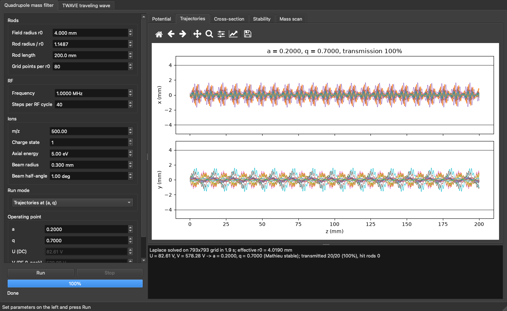

Ion Sim solves electrode fields on a grid, flies thousands of ions through them, and checks the results against theory. It currently models two devices:

* **Quadrupole mass filter:** four round rods with RF + DC, a Laplace field solve, RK4 ion flight and a Mathieu stability check.
* **TWAVE traveling-wave ion mobility separation:** stepped electrode boards in 4 Torr gas, with mobility drift and diffusion.

---

## Contents

* [Quick start](#quick-start)
* [The desktop app](#the-desktop-app)
* [Example results](#example-results)
* [How it works](#how-it-works)
* [Validation](#validation)
* [Limits and roadmap](#limits-and-roadmap)
* [Project layout](#project-layout)

---

## Quick start

```bash
git clone https://github.com/anderson509chris/ION-SIM.git
cd ION-SIM
python3 -m venv .venv
source .venv/bin/activate          # Windows: .venv\Scripts\activate
pip install -r requirements.txt
python ion_sim_app.py              # launches the Ion Sim window
```

Requires Python 3.12 or newer. Dependencies: NumPy, SciPy, Matplotlib and PySide6.

### Standalone app (no Python needed)

| Platform | How |
|---|---|
| **Download** | Every push builds Windows, macOS and Linux versions. Grab the zip from the latest run on the [Actions tab](https://github.com/anderson509chris/ION-SIM/actions). |
| Windows | Double-click `build_windows.bat`, then run `dist\IonSim\IonSim.exe`. |
| macOS / Linux | `./build.sh`, then open `dist/`. |

PyInstaller can only build for the operating system it runs on, which is why there is one build per OS.

---

## The desktop app

Set the parameters on the left and press **Run**. Runs happen in the background with a progress bar and a **Stop** button. Every plot can be zoomed, panned and saved, and **File > Export results (CSV)** writes the numbers out.

### Quadrupole mass filter

Rod geometry, RF frequency, ion beam and operating point (a, q or U, V, kept in sync). It runs either a single operating point or a full mass scan. Plot tabs: Potential, Trajectories, Cross-section, Stability and Mass scan.

| Ion trajectories | Stability diagram |
|---|---|
|  | 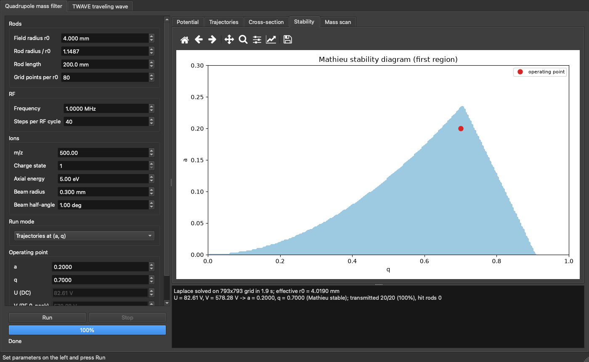 |

### TWAVE traveling wave

Board geometry, wave amplitude, speed and shape, gas pressure and temperature, and a list of ion mobilities (K0) to separate. It runs either a single separation or a sweep over wave speed. Plot tabs: TW field, Arrival times, Ion velocity and Speed sweep.

| Arrival-time distribution | Traveling-wave field |
|---|---|
| 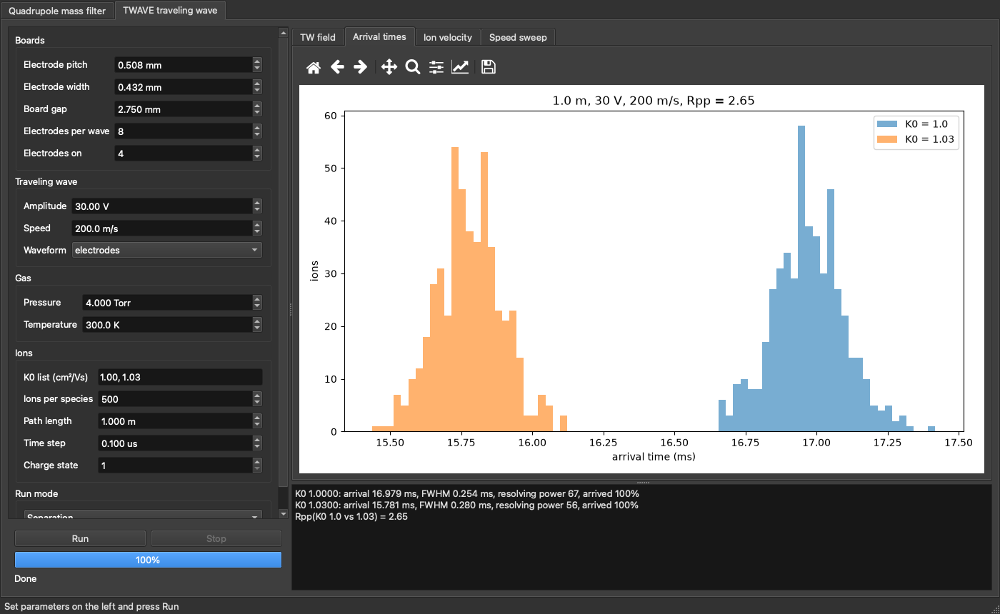 | 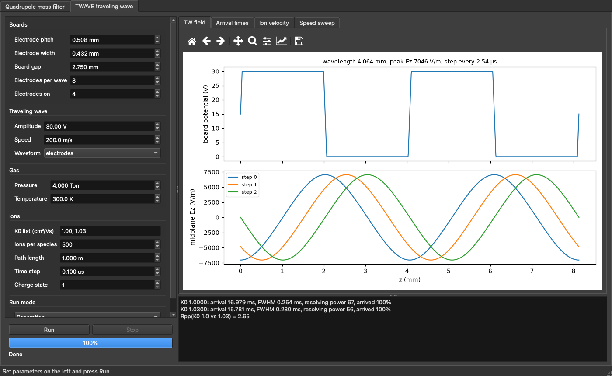 |

<sub>To refresh these screenshots after changing the GUI, run `python docs/make_screenshots.py`.</sub>

---

## Example results

The scripts in `examples/` reproduce these plots without the GUI:

```bash
python examples/quad_demo.py       # ~1 min, writes PNGs 1-4 to out/
python examples/twave_demo.py      # a few min, writes PNGs 5-8 to out/
```

### Quadrupole mass filter

| | |
|---|---|
| 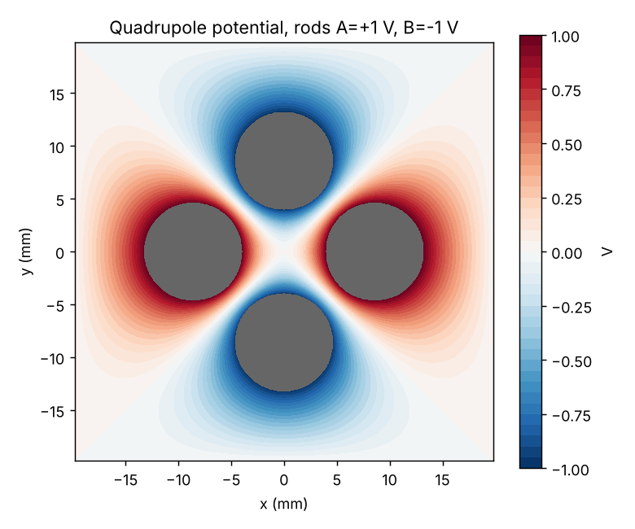 | 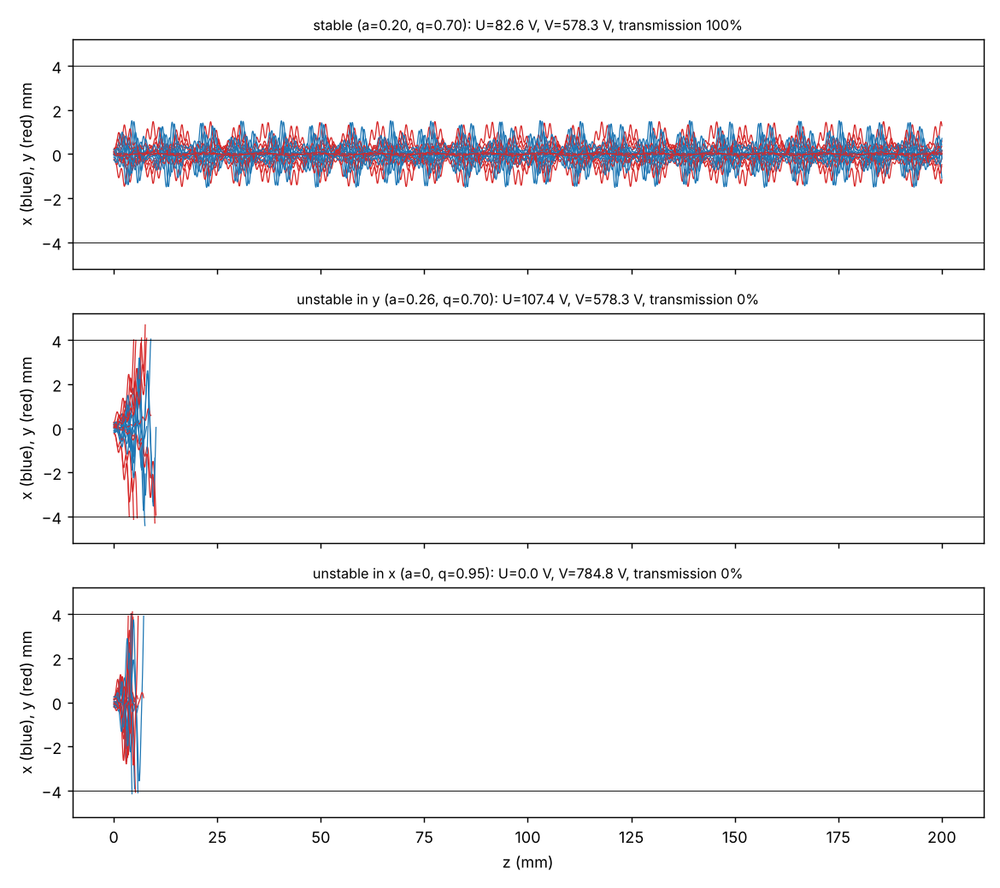 |
| **Field solve.** Potential of the four round rods (A = +1 V, B = −1 V) inside a grounded can. | **Ion flight.** A stable point transmits 100%. Points just outside the stability region in y or x crash into the rods within a few mm. |
| 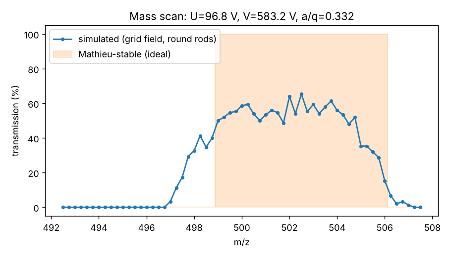 | 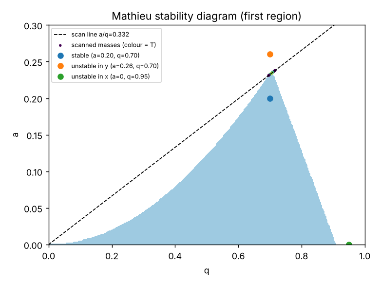 |
| **Mass scan.** Simulated transmission at a/q = 0.332 against the ideal Mathieu-stable band (m/z 499–506). | **Mathieu stability diagram.** The first stability region, the scan line, and the three operating points from the trajectory plot. |

### TWAVE traveling-wave separation

| | |
|---|---|
| 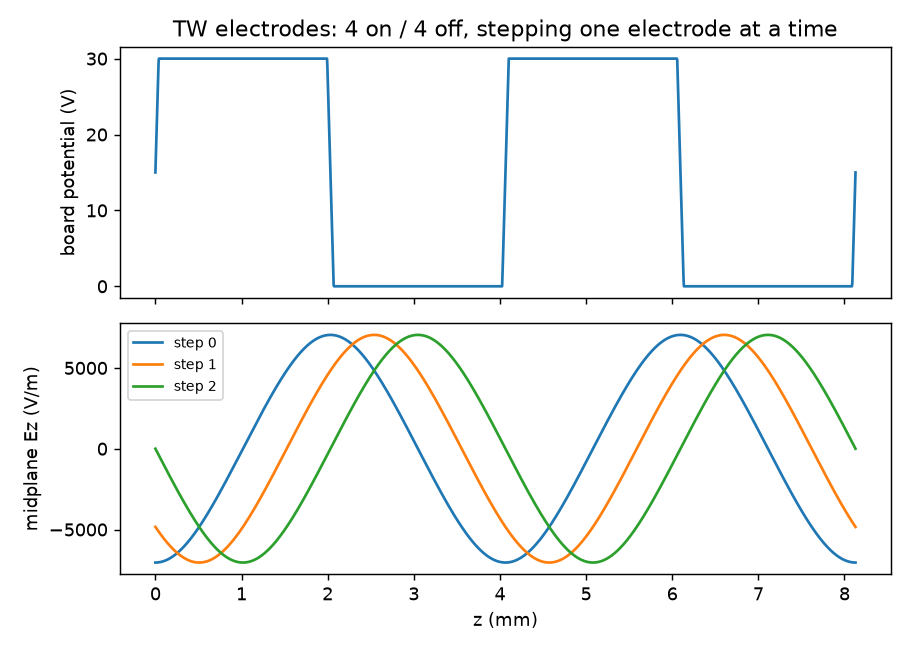 | 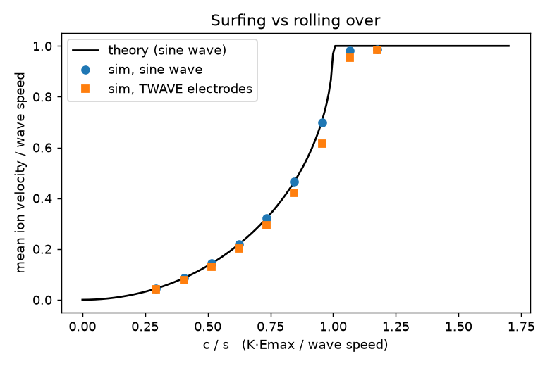 |
| **Traveling wave.** 4 electrodes on / 4 off, stepping one electrode at a time, and the resulting midplane field. | **Surfing vs rolling over.** Mean ion velocity against c/s, with simulation matching the sine-wave theory. |
| 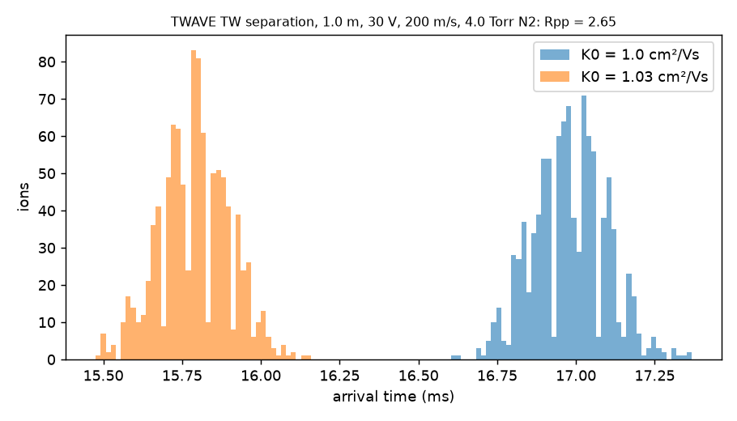 | 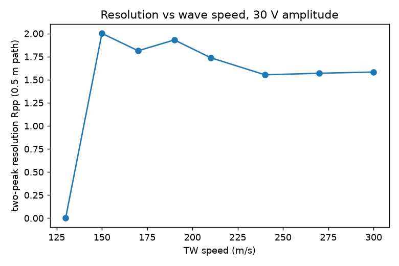 |
| **Separation.** K0 = 1.00 and 1.03 cm²/Vs over 1 m at 30 V, 200 m/s, 4 Torr N₂: two-peak resolution Rpp = 2.65. | **Tuning curve.** Two-peak resolution against wave speed over a 0.5 m path. |

---

## How it works

The quadrupole uses the same approach as SIMION:

| Step | Module | What it does |
|---|---|---|
| Geometry | `ionsim/geometry.py` | Paints electrodes onto a uniform 2D grid (x, y cross-section). `quadrupole_rods(r0, rod_ratio=1.1487)` builds the four rods. The outer edge is a grounded can. |
| Field solve | `ionsim/solver.py` | Sparse direct Laplace solve, once per electrode at 1 V ("basis potentials"). |
| Fields | `ionsim/fields.py` | Superposes basis potentials with time-dependent voltages (SIMION's "fast adjust") and interpolates the field bilinearly. `IdealQuadField` is the analytic hyperbolic field used for checks. |
| Flight | `ionsim/integrator.py` | Vectorised RK4 over thousands of ions, with electrode hit detection and staggered birth times to sample the RF phase. |
| Theory | `ionsim/mathieu.py` | a/q from U, V, m, r0 and f, plus a Floquet-based stability test (no lookup tables). |

Rods A (on x) sit at +(U + V cos Ωt) and rods B (on y) at −(U + V cos Ωt), with V zero-to-peak, so

a = 8eU / (m r0² Ω²),  q = 4eV / (m r0² Ω²)

### TWAVE traveling wave (`ionsim/twave.py`)

* **Boards and electrodes:** two boards `gap` apart, with TW electrodes at `pitch` and `width`, 8 per wavelength, 4 on / 4 off, stepped one electrode every pitch/speed. The field between the boards comes from an exact Fourier (Laplace) solution of the periodic electrode pattern, with a linear ramp across the insulating gaps.
* **Ion motion:** 4 Torr is the mobility regime, so ions follow dz = K·E dt + √(2D dt)·N(0,1). K comes from K0, pressure and temperature, and D from the Einstein relation.

### Default parameters

| Quadrupole (`examples/quad_demo.py`) | TWAVE (`examples/twave_demo.py`) |
|---|---|
| r0 = 4.0 mm, rod radius = 1.1487 r0 | pitch 0.508 mm, width 0.432 mm, gap 2.75 mm |
| f = 1.0 MHz, m/z 500, rod length 200 mm | 30 V, 200 m/s |
| 5 eV axial energy | 4 Torr N₂, 300 K |
| grid spacing r0/80, 40 RK4 steps per RF cycle | K0 = 1.00 and 1.03 cm²/Vs over 1 m |

---

## Validation

**Quadrupole**
* Grid field vs ideal hyperbolic: 0.99 near the axis (rod staircasing). This is expressed as an effective r0 = 4.019 mm and used for a/q.
* Operating points: (a = 0.20, q = 0.70) transmits 100%. (0.26, 0.70) and (0, 0.95) transmit 0%, matching Mathieu.
* Mass scan at a/q = 0.332: the Mathieu-stable band is 499–506. The simulated FWHM is 498–505, with soft edges from the finite number of RF cycles (~145), as expected for a real filter.

**TWAVE**
* For an ideal sine wave the mean velocity must follow theory: s for surfing (c ≥ s) and s − √(s² − c²) for rolling over, where c = K·Emax. The simulation matches to within 0.017 of the wave speed.
* K0 = 1.00 vs 1.03 cm²/Vs over 1 m gives resolving powers of 60 / 63 and a two-peak resolution of Rpp = 2.65.

---

## Limits and roadmap

**Quadrupole, not modelled yet**
* 2D field only: no fringe fields at the rod entrance and exit (a 3D grid is the obvious next field upgrade).
* No space charge and no gas.
* Pure NumPy. Numba on `efield`/RK4 would give a large speed-up as ion counts grow.

**TWAVE, not modelled yet**
* The RF guard confinement across the device (ions ride the midplane), turns, space charge, high-field mobility (E/N dependence), and real ion injection or trapping.
* A 13 m serpentine is just a longer `PATH`, and the run time grows with it.

**Next: drag-field quadrupole (collision cell).** The integrator already has the three hooks this needs:

1. **Axial drag field:** a new `FieldSource` that adds E_z(z) (from segmented rods, tilted or tapered auxiliary electrodes, or a resistive coating). For segmented rods, solve an axial 1D/3D problem and add a DC ramp per segment.
2. **Gas collisions:** a `hooks` entry that applies, per step, a collision probability P = 1 − exp(−n σ v_rel dt) with a hard-sphere (or Langevin) cross section, and a centre-of-mass random scatter against a thermal gas atom (He, N₂ or Ar at a set pressure and temperature).
3. **Optional viscous drag shortcut:** a `forces` entry with mobility K, a = (q/m)E − v/τ, which is fast at high pressure.

Outputs to add then: transit-time distributions, energy thermalisation, CID energy, and transmission vs pressure.

---

## Project layout

```
ION-SIM/
├── ion_sim_app.py          # desktop app entry point
├── ionsim/
│   ├── geometry.py         # electrodes on a grid
│   ├── solver.py           # Laplace basis solves
│   ├── fields.py           # fast-adjust superposition, interpolation
│   ├── integrator.py       # vectorised RK4 ion flight
│   ├── mathieu.py          # a/q and stability
│   ├── twave.py            # traveling-wave boards and mobility flight
│   └── gui/                # PySide6 app: quad_tab, twave_tab, shared widgets
├── examples/               # quad_demo.py, twave_demo.py
├── out/                    # example plots
├── docs/                   # screenshots and the script that makes them
├── build.sh, build_windows.bat, ion_sim.spec   # standalone builds
└── .github/workflows/build.yml                 # CI builds for all three OSes
```
